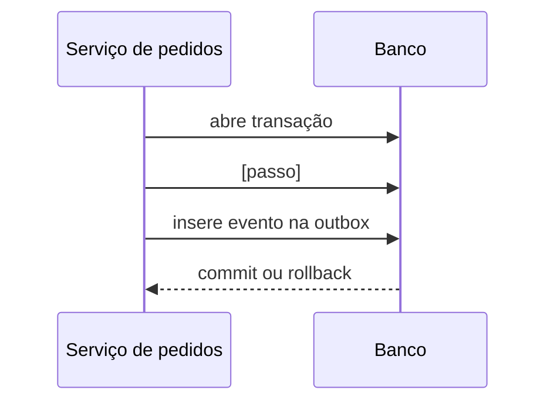

# FDD: [Nome da feature]

| Campo | Valor |
| --- | --- |
| Versão | v1 |
| Data | AAAA-MM-DD |
| Responsável | [nome] |
| Status | Rascunho / Em revisão / Aprovado |
| Documentos relacionados | [PRD](./PRD.md) · [RFC](./RFC.md) · [ADRs](./adrs/) |

<!--
REGRAS DE USO (apague este bloco no documento final)
- O FDD responde "como construir, em detalhe?". Um dev deve conseguir começar a codar só com ele.
- Não repita a justificativa das decisões: linke o ADR. Não repita o raciocínio do RFC.
- Toda afirmação termina com [T-xx] (transcrição) ou [código: caminho].
- Item de design que a reunião NÃO definiu: marque "(proposta de design, sem origem na reunião)".
- Ponto que a reunião deixou aberto: se for uma lacuna técnica explicitamente encaminhada ao FDD, especifique uma solução como proposta de design quando houver base suficiente. Se depender de decisão de negócio, aprovação de segurança ou mudança arquitetural, registre em "Questões pendentes"; não decida isso em silêncio.
- Itens descartados ou adiados aparecem só em "Escopo e exclusões".
- Todo caminho de arquivo citado deve ser verificado com `ls` antes de entrar aqui.
- Números (timeouts, tentativas, intervalos, limites) sempre com origem.
-->

---

## 1. Contexto e motivação técnica

- **Situação técnica atual:** [o que o sistema faz hoje e qual lacuna técnica existe] [código: caminho]
- **Motivação:** [por que a feature precisa existir, em termos técnicos] [T-xx]
- **Restrições herdadas:** [stack, padrões, limites que a solução deve respeitar] [origem]
- **Documentos de origem:** proposta em [RFC](./RFC.md); decisões em [ADRs](./adrs/).

## 2. Objetivos técnicos

- [Objetivo técnico verificável 1] [T-xx]
- [Objetivo técnico verificável 2] [T-xx]
- [Objetivo técnico verificável 3] [T-xx]

> Cada objetivo deve virar pelo menos um critério de aceite na seção 14.

## 3. Escopo e exclusões

### Incluído

- [item] [origem]

### Excluído

| Item | Situação | Origem |
| --- | --- | --- |
| [item] | Descartado | [T-xx] |
| [item] | Adiado (fase futura) | [T-xx] |
| Alteração de código nesta entrega | Restrição do desafio | enunciado |

## 4. Componentes

| Componente | Responsabilidade | Novo ou existente | Origem |
| --- | --- | --- | --- |
| [nome] | [uma frase] | Novo | [T-xx] |
| [nome] | [uma frase] | Existente | [código: caminho] |


## 5. Modelo de dados

> Descreva campos e finalidade, sem escrever o schema Prisma final. Siga as convenções de `prisma/schema.prisma`.

### `[NomeDaEntidade]`

| Campo | Tipo | Finalidade | Origem |
| --- | --- | --- | --- |
| `id` | UUID | [..] | [código: caminho] |
| `[campo]` | [tipo] | [..] | [origem] |

**Índices mínimos:** [lista e motivo]

<!-- Repita para cada entidade (ex.: configuração, outbox, histórico de entregas, DLQ) -->

## 6. Fluxos detalhados

### FLOW-01: Criação do evento na outbox



1. [passo numerado, com o ponto exato do código] [origem]
2. [passo]
3. **Falha:** [o que acontece e qual o efeito na transação] [origem]

**Snapshot do evento (exemplo):**

```json
{ }
```

### FLOW-02: Polling e processamento pelo worker

1. [passo] [origem]
2. [passo]

### FLOW-03: Retry

| Retentativa | Intervalo | Origem |
| --- | --- | --- |
| 1 | [valor] | [T-xx] |

[Regra de contagem: a chamada inicial conta ou não como tentativa? Explicite.]

### FLOW-04: DLQ

1. [condição de entrada] [origem]
2. [o que é persistido e o que acontece com a outbox]

### FLOW-05: [Fluxos extras que a reunião definiu: replay, rotação de secret etc.]

1. [passo]

<!-- Cada fluxo termina com o caso de erro. Fluxo sem tratamento de falha está incompleto. -->

## 7. Contratos públicos

**Convenções:** prefixo de rota, autenticação, envelope de erro, paginação, tudo igual ao que o código já usa [código: caminho].

### API-01: [Nome da operação]

`MÉTODO /caminho`

**Headers:** `Authorization: Bearer <JWT>`, `Content-Type: application/json`

**Request:**

```json
{ }
```

**Response `2xx`:**

```json
{ }
```

**Status codes:** `2xx` [significado] · `4xx` [significado] · `404` [significado]

**Semântica:** [idempotência, efeitos colaterais, regras de autorização] [origem]

**Origem do endpoint:** [T-xx] ou "(proposta de design, sem origem na reunião)"

<!-- Repita para cada endpoint (mínimo de 4 com request, response e status codes) -->

## 8. Contrato outbound (chamada enviada ao cliente)

```http
POST /caminho-do-cliente HTTP/1.1
Content-Type: application/json
X-Event-Id: <uuid>
X-Signature: <assinatura>
```

| Header | Valor | Finalidade | Origem |
| --- | --- | --- | --- |
| `[nome]` | [valor] | [..] | [T-xx] |

**Assinatura:** [algoritmo, o que é assinado, onde a assinatura vai] [T-xx]

**Critério de sucesso da entrega:** [quais respostas contam como sucesso e quais como falha] [T-xx]

## 9. Matriz de erros

| Código | HTTP | Condição | Reaproveita classe | Origem |
| --- | ---: | --- | --- | --- |
| `WEBHOOK_[NOME]` | [4xx/5xx/interno] | [quando ocorre] | `[AppError ou subclasse real]` | [origem] |

> Códigos internos (que nunca chegam como resposta HTTP) ficam marcados como "interno".

## 10. Estratégias de resiliência

| Mecanismo | Regra | Origem |
| --- | --- | --- |
| Atomicidade | [..] | [T-xx] |
| Timeout | [valor] | [T-xx] |
| Retry e backoff | [regra, remetendo ao FLOW-03] | [T-xx] |
| DLQ | [..] | [T-xx] |
| Idempotência | [..] | [T-xx] |
| Fallback | [..] | [T-xx] |
| Encerramento gracioso do worker | [..] | [código: caminho] |

## 11. Observabilidade

### Métricas

- `[nome_da_metrica]`: [o que mede]

### Logs

- Eventos estruturados: `[nome_do_evento]`
- Campos de correlação: [lista]
- **Nunca registrar:** [secrets, assinaturas, tokens]

### Tracing

- [como o contexto é propagado entre a API e o worker; spans previstos]

> Se a reunião não definiu a ferramenta, diga isso em vez de escolher uma.

## 12. Integração com o sistema existente

| Caminho real (verificado com `ls`) | Como o módulo se integra |
| --- | --- |
| `src/...` | [ponto exato de extensão: método, função, classe] |
| `src/...` | [..] |
| `src/...` | [..] |
| `prisma/schema.prisma` | [..] |

> Mínimo de 4 caminhos. Descreva o gancho concreto (ex.: "dentro do `$transaction` de `changeStatus`"), não só o nome do arquivo.

## 13. Dependências e compatibilidade

- [dependência existente e versão, se relevante] [código: caminho]
- [dependência nova, ou "não decidida na reunião"] [origem]
- **Compatibilidade:** [o que não pode quebrar; ex.: testes existentes, valores do enum de status]
- **Para o consumidor externo:** [o que ele precisa implementar]

## 14. Critérios de aceite técnicos

- [ ] [condição verificável ligada a um objetivo da seção 2]
- [ ] [condição verificável ligada a um fluxo]
- [ ] [condição verificável ligada a um contrato]
- [ ] Testes existentes continuam passando

### Estratégia de testes

| Nível | O que cobrir |
| --- | --- |
| Unidade | [..] |
| Integração | [..] |
| Ponta a ponta | [..] |
| Segurança | [..] |

## 15. Riscos e mitigação

| Risco | Probabilidade | Impacto | Mitigação | Origem |
| --- | --- | --- | --- | --- |
| [risco] | Baixa/Média/Alta | Baixo/Médio/Alto | [ação] | [origem] |

## 16. Questões pendentes antes da implementação

1. [Questão que depende de decisão de negócio, aprovação de segurança ou mudança arquitetural, com link para a questão em aberto da RFC e origem T-xx]
2. [Lacuna técnica que não pôde ser especificada com as fontes disponíveis, com justificativa, impacto e origem]

> Não reabra aqui decisões já aprovadas na RFC/ADRs. Lacunas técnicas explicitamente encaminhadas ao FDD devem ser resolvidas no próprio FDD como proposta de design quando houver base suficiente. Mantenha como pendente apenas o que realmente depende de decisão externa ou não pode ser concluído com as evidências disponíveis.

## 17. ADRs relacionados

- [ADR-001](./adrs/ADR-001-titulo.md): [decisão em uma frase]
- [ADR-002](./adrs/ADR-002-titulo.md): [decisão em uma frase]