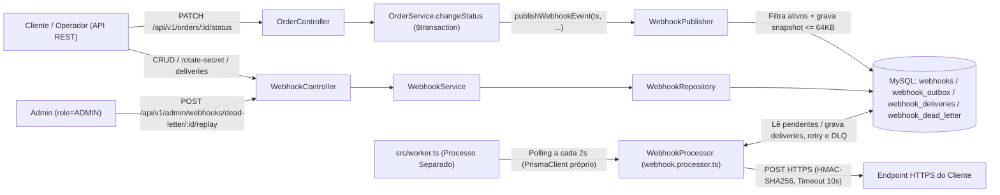
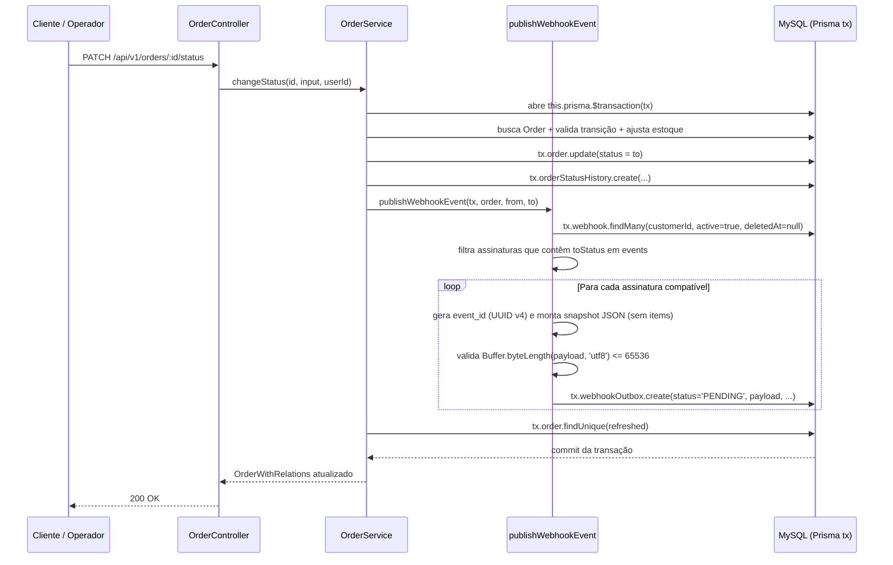
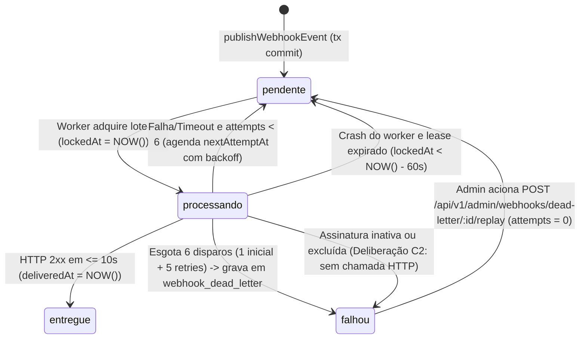

# FDD: Notificação de Mudança de Status de Pedidos via Webhooks

| Campo | Valor |
| --- | --- |
| Versão | v1 |
| Data | 2026-10-24 |
| Responsável | Larissa (Tech Lead), Diego (Arquiteto de Software), Bruno (Desenvolvedor Backend), Sofia (Engenheira de Segurança), Marcos (Product Owner) `[T-55]`, `[T-65]` |
| Status | Aprovado |
| Documentos relacionados | [PRD](./PRD.md) · [RFC](./RFC.md) · [ADRs](./adrs/) |

---

## 1. Contexto e motivação técnica

- **Situação técnica atual:** O Order Management System (OMS) gerencia o ciclo de vida dos pedidos em `OrderService.changeStatus`, que executa uma transação interativa no MySQL (`this.prisma.$transaction`) responsável por validar a transição de estado (`canTransition`), debitar ou repor estoque em `products.stockQuantity`, atualizar `orders.status` e inserir um registro em `order_status_history`, sem qualquer mecanismo de emissão de eventos ou notificação assíncrona externa `[T-56]`, `[código: src/modules/orders/order.service.ts:126-179]`, `[código: src/modules/orders/order.status.ts:3-37]`, `[código: prisma/schema.prisma:56-131]`.
- **Motivação:** Clientes B2B integrados ao OMS (Atlas, MaxDistribuição e Nova Cargo) consultam repetidamente `GET /api/v1/orders` em loop por falta de notificações ativas de mudança de status, gerando sobrecarga desnecessária de leitura no MySQL e na API HTTP, além de risco comercial de perda do cliente Atlas caso a funcionalidade outbound com latência operacional inferior a 10 segundos não seja entregue até o fim do trimestre (final de novembro) `[T-01]`, `[T-02]`, `[T-03]`, `[T-52]`, `[T-53]`, `[código: src/modules/orders/order.routes.ts:16]`.
- **Restrições herdadas:** A solução deve operar sobre a stack existente Node.js (`>=20`), TypeScript (`5.6.3`), Express (`4.21.1`), Prisma (`5.22.0`) com MySQL, Zod (`3.23.8`) e Pino (`9.5.0`), mantendo reuso máximo dos padrões do repositório (`src/modules/`, `AppError` com códigos `WEBHOOK_*`, `errorMiddleware`, `validate`, `authenticate`/`requireRole`, `createPrismaClient()` e ciclo de vida de `src/server.ts`), sem introduzir nova infraestrutura externa de mensageria e operando com processo worker separado em instância única (*single-worker*) nesta fase `[T-05]`, `[T-08]`, `[T-10]`, `[T-11]`, `[T-18]`, `[T-21]`, `[T-23]`, `[T-24]`, `[T-25]`, `[T-48]`, `[T-57]`, `[T-58]`, `[T-59]`, `[código: package.json:7-53]`, `[ADR-001]`, `[ADR-002]`, `[ADR-006]`.
- **Documentos de origem:** Proposta arquitetural aprovada em [RFC](./RFC.md) (incluindo as deliberações aprovadas **A1**, **B1** e **C2** e os cinco pré-requisitos obrigatórios antes da implementação e pré-deploy); decisões arquiteturais em [ADRs](./adrs/) ([ADR-001](./adrs/ADR-001-outbox-transacional-no-mysql.md) a [ADR-007](./adrs/ADR-007-payload-snapshot-e-limite-de-64kb.md)).

## 2. Objetivos técnicos

- **OBJ-01 (Captura transacional atômica e filtrada na outbox):** Persistir eventos de mudança de status na tabela de outbox do MySQL com chave primária UUID e payload JSON pré-renderizado como snapshot imutável (sem lista de itens e limitado a 64 KB com rollback transacional integral em caso de excesso conforme Deliberação A1) dentro da mesma transação `this.prisma.$transaction` de `OrderService.changeStatus` (sem emissão em `OrderService.create` conforme Deliberação B1), filtrando na inserção apenas assinaturas ativas do cliente que monitoram o status de destino `[T-01]`, `[T-05]`, `[T-19]`, `[T-34]`, `[T-36]`, `[T-39]`, `[T-40]`, `[T-51]`, `[T-56]`, `[RFC: Proposta técnica]`, `[ADR-001]`, `[ADR-007]`, `[código: src/modules/orders/order.service.ts:126-179]`.
- **OBJ-02 (Despacho assíncrono em worker dedicado com ordenação por pedido):** Processar os eventos `pendente` por meio de um processo Node.js independente (`src/worker.ts`, acionado via `npm run worker`) com instância dedicada de `PrismaClient` e polling a cada 2 segundos em lotes pequenos indexados por `status` e `created_at`, contribuindo para a meta operacional de latência inferior a 10 segundos no caminho nominal e preservando a ordem sequencial de entrega por `order_id` em execução *single-worker* inclusive durante janelas de retry `[T-02]`, `[T-07]`, `[T-08]`, `[T-10]`, `[T-11]`, `[T-25]`, `[T-58]`, `[RFC: Proposta técnica]`, `[ADR-002]`, `[ADR-005]`, `[código: src/config/database.ts:4-10]`, `[código: src/server.ts:6-27]`.
- **OBJ-03 (Entrega at-least-once, resiliência com backoff, DLQ e replay auditado):** Garantir entrega *at-least-once* com cabeçalho `X-Event-Id` (UUID) para deduplicação no receptor, timeout de 10 segundos por requisição HTTP tratado como falha passível de retry, escalonamento de retentativas nos intervalos `1m, 5m, 30m, 2h, 12h`, isolamento de falhas esgotadas na tabela `webhook_dead_letter` e reprocessamento manual via `POST /api/v1/admin/webhooks/dead-letter/:id/replay` restrito ao papel `ADMIN` com log de auditoria `[T-12]`, `[T-13]`, `[T-14]`, `[T-15]`, `[T-20]`, `[T-30]`, `[T-35]`, `[T-37]`, `[T-59]`, `[RFC: Proposta técnica]`, `[ADR-003]`, `[ADR-005]`, `[código: src/middlewares/auth.middleware.ts:42-61]`.
- **OBJ-04 (Autenticação HMAC-SHA256, rotação de secret de 24h e segurança de transporte):** Assinar cada requisição outbound com HMAC-SHA256 no cabeçalho `X-Signature` usando secret exclusiva por endpoint, enviar os cabeçalhos padronizados (`X-Event-Id`, `X-Signature`, `X-Timestamp`, `X-Webhook-Id`, `Content-Type: application/json`), suportar rotação programática de secret com período de tolerância de 24 horas em paralelo, exigir protocolo HTTPS via Zod, aplicar a verificação de assinatura ativa e URL/credencial vigentes no envio (Deliberação C2) e mascarar segredos nos logs do Pino `[T-16]`, `[T-17]`, `[T-18]`, `[T-24]`, `[T-26]`, `[T-37]`, `[T-49]`, `[T-61]`, `[RFC: Proposta técnica]`, `[ADR-004]`, `[ADR-006]`, `[código: src/shared/logger/index.ts:4-11]`.
- **OBJ-05 (Gestão CRUD de assinaturas e consulta de histórico de entregas):** Disponibilizar sob `/api/v1` em `src/modules/webhooks/` os endpoints REST de gestão de assinaturas (`POST`, `GET`, `PATCH`, `DELETE`), rotação de secret e consulta das últimas 100 tentativas de entrega (`GET /api/v1/webhooks/:id/deliveries` com `sucesso/falha`, `payload`, `response` e `tempo de resposta`), reutilizando `AppError` com prefixo `WEBHOOK_`, `errorMiddleware`, `validate` e `authenticate` `[T-21]`, `[T-23]`, `[T-24]`, `[T-26]`, `[T-27]`, `[T-28]`, `[T-29]`, `[T-48]`, `[T-49]`, `[T-50]`, `[T-57]`, `[ADR-006]`, `[código: src/app.ts:67]`, `[código: src/routes/index.ts:13-31]`.

## 3. Escopo e exclusões

### Incluído

- Módulo `src/modules/webhooks/` estruturado nas camadas `controller`, `service`, `repository`, `routes`, `schemas` e processador `webhook.processor.ts` (escolhido dentre as opções de `[T-22]`) `(proposta de design, sem origem na reunião)`, montado sob `/api/v1` `[T-21]`, `[T-22]`, `[T-48]`, `[ADR-006]`, `[código: src/app.ts:67]`, `[código: src/routes/index.ts:13-31]`.
- Endpoints CRUD (`POST`, `GET`, `PATCH`, `DELETE`) para configuração de assinaturas de webhooks por `customer_id` (fora do JWT) com validação de URL HTTPS via Zod e retorno da secret gerada no cadastro `[T-18]`, `[T-26]`, `[T-27]`, `[T-28]`, `[T-50]`, `[T-61]`, `[ADR-004]`, `[ADR-006]`.
- Endpoint de rotação de secret por assinatura com janela de coexistência de 24 horas entre a chave anterior e a chave nova `[T-17]`, `[T-49]`, `[ADR-004]`.
- Publicação transacional na tabela de outbox por meio da função auxiliar `publishWebhookEvent(tx, order, fromStatus, toStatus)` invocada exclusivamente dentro de `OrderService.changeStatus` (Deliberação B1), filtrando assinaturas ativas que monitoram o status de destino, gerando snapshot imutável sem `items` e aplicando rollback transacional caso o payload exceda 64 KB (Deliberação A1) `[T-01]`, `[T-05]`, `[T-19]`, `[T-34]`, `[T-36]`, `[T-39]`, `[T-40]`, `[T-51]`, `[T-56]`, `[RFC: Deliberações A1 e B1]`, `[ADR-001]`, `[ADR-007]`, `[código: src/modules/orders/order.service.ts:126-179]`.
- Entrypoint `src/worker.ts` e script `npm run worker` em processo Node.js separado com `PrismaClient` próprio na mesma `DATABASE_URL`, polling a cada 2 segundos em lote pequeno, verificação de assinatura ativa com uso de URL e secret vigentes no disparo (Deliberação C2), timeout HTTP de 10 segundos e encerramento gracioso em `SIGINT`/`SIGTERM` `[T-07]`, `[T-08]`, `[T-10]`, `[T-25]`, `[T-35]`, `[T-58]`, `[RFC: Deliberação C2]`, `[ADR-002]`, `[código: src/config/database.ts:4-10]`, `[código: src/server.ts:6-27]`.
- Assinatura HMAC-SHA256 enviada em `X-Signature` acompanhada dos cabeçalhos `X-Event-Id`, `X-Timestamp`, `X-Webhook-Id` e `Content-Type: application/json`, sob garantia *at-least-once* e ordenação por `order_id` em *single-worker* `[T-11]`, `[T-16]`, `[T-20]`, `[T-37]`, `[ADR-004]`, `[ADR-005]`.
- Política de retry nos intervalos `1m, 5m, 30m, 2h, 12h`, persistência de falhas esgotadas em `webhook_dead_letter` e endpoint `POST /api/v1/admin/webhooks/dead-letter/:id/replay` restrito a `ADMIN` via `requireRole('ADMIN')` com log de auditoria `[T-12]`, `[T-13]`, `[T-14]`, `[T-15]`, `[T-30]`, `[T-59]`, `[ADR-003]`, `[código: src/middlewares/auth.middleware.ts:49-61]`.
- Registro individual de cada tentativa de entrega e endpoint `GET /api/v1/webhooks/:id/deliveries` retornando os últimos 100 disparos da assinatura com `sucesso/falha`, `payload`, `response` e `tempo de resposta` `[T-29]`.
- Padronização de erros `AppError` com prefixo `WEBHOOK_` (`WEBHOOK_NOT_FOUND`, `WEBHOOK_INVALID_URL`, `WEBHOOK_SECRET_REQUIRED` e códigos complementares), extensão de `redactPaths` no logger Pino e documentação da integração no portal do desenvolvedor `[T-23]`, `[T-24]`, `[T-48]`, `[T-54]`, `[T-57]`, `[ADR-006]`, `[código: src/shared/errors/app-error.ts:3-16]`, `[código: src/shared/logger/index.ts:4-11]`.

### Excluído

| Item | Situação | Origem |
| --- | --- | --- |
| Recebimento de webhooks inbound (de sistemas externos para o OMS) | Fora de escopo (escopo estritamente outbound) | `[T-03]` |
| Disparo HTTP síncrono dentro de `OrderService.changeStatus` | Descartado | `[T-04]`, `[ADR-001]` |
| Uso de Redis Streams como fila/mensageria externa | Descartado (*overengineering*) | `[T-06]`, `[ADR-001]`, `[ADR-002]` |
| Uso de triggers nativas no banco de dados MySQL para notificar o worker | Descartado (MySQL não possui listener nativo) | `[T-09]`, `[ADR-002]` |
| Retentativa indefinida com backoff sem teto de tentativas | Descartado | `[T-41]`, `[ADR-003]` |
| Limite reduzido de apenas 3 tentativas de retry | Descartado (insuficiente para manutenção de ~2h) | `[T-42]`, `[ADR-003]` |
| Marcar apenas status `failed` na própria outbox sem tabela `webhook_dead_letter` separada | Descartado | `[T-43]`, `[ADR-003]` |
| Garantia de entrega *exactly-once* | Descartado (exigiria coordenação complexa nos dois lados) | `[T-44]`, `[ADR-005]` |
| Truncamento de payloads que ultrapassem 64 KB ("erra, não trunca") | Descartado | `[T-45]`, `[ADR-007]` |
| Injeção direta do `WebhookRepository` no construtor de `OrderService` | Descartado (preferiu-se `publishWebhookEvent` recebendo `tx`) | `[T-60]`, `[ADR-001]`, `[ADR-006]` |
| Emissão de evento de webhook na criação inicial do pedido (`OrderService.create`) | Descartado na revisão da RFC (Deliberação B1) | `[T-01]`, `[T-34]`, `[RFC: Deliberação B1]` |
| Rotina de arquivamento/limpeza automática das linhas com status `entregue` na outbox | Adiado (fase futura) | `[T-47]`, `[ADR-001]` |
| Execução concorrente de múltiplos workers (*multi-worker* com particionamento por `order_id` ou lock pessimista) | Adiado ("problema do futuro") | `[T-46]`, `[ADR-002]`, `[ADR-005]` |
| Notificação por e-mail ao cliente sobre falhas recorrentes de entrega | Adiado (fora do escopo desta fase) | `[T-31]`, `[ADR-003]` |
| Rate limiting de saída para chamadas HTTP do worker | Adiado (avaliação futura) | `[T-32]`, `[ADR-003]` |
| Dashboard visual de gestão de webhooks | Fora de escopo (projeto separado do time de frontend) | `[T-33]` |
| Alteração de código-fonte (`src/`, `prisma/`, `tests/`, `TRANSCRICAO.md`) nesta entrega | Restrição do desafio | `GEMINI.md` |

## 4. Componentes

| Componente | Responsabilidade | Novo ou existente | Origem |
| --- | --- | --- | --- |
| `OrderService` (`src/modules/orders/order.service.ts`) | Executa a mudança de status em `changeStatus` dentro de `this.prisma.$transaction` e invoca `publishWebhookEvent(tx, order, fromStatus, toStatus)` na mesma transação. | Existente (estendido) | `[T-05]`, `[T-34]`, `[T-56]`, `[código: src/modules/orders/order.service.ts:126-179]` |
| `publishWebhookEvent` (`src/modules/webhooks/webhook.publisher.ts` ou exportado por `webhook.service.ts`) | Filtra assinaturas ativas do `customer_id` para `toStatus`, serializa o snapshot imutável, valida o teto de 64 KB e insere os registros `pendente` na outbox usando `tx`. | Novo | `[T-05]`, `[T-19]`, `[T-34]`, `[T-40]`, `[T-51]`, `[ADR-001]`, `[ADR-007]` `(proposta de design, sem origem na reunião)` |
| `WebhookController` (`src/modules/webhooks/webhook.controller.ts`) | Recebe requisições HTTP de CRUD de assinaturas, rotação de secret, listagem de `deliveries` e replay da DLQ, delegando ao `WebhookService` e ao `errorMiddleware`. | Novo | `[T-15]`, `[T-21]`, `[T-24]`, `[T-26]`, `[T-28]`, `[T-29]`, `[T-48]`, `[T-49]`, `[ADR-006]` |
| `WebhookService` (`src/modules/webhooks/webhook.service.ts`) | Implementa regras de negócio de assinaturas, geração e rotação de secrets com tolerância de 24h, consulta das últimas 100 entregas e replay auditado da DLQ. | Novo | `[T-15]`, `[T-17]`, `[T-21]`, `[T-26]`, `[T-28]`, `[T-29]`, `[T-30]`, `[T-49]`, `[ADR-003]`, `[ADR-004]`, `[ADR-006]` |
| `WebhookRepository` (`src/modules/webhooks/webhook.repository.ts`) | Encapsula consultas e mutações Prisma nas tabelas de configuração de webhooks, outbox, histórico de entregas (`deliveries`) e `webhook_dead_letter`. | Novo | `[T-05]`, `[T-14]`, `[T-21]`, `[T-29]`, `[T-61]`, `[ADR-001]`, `[ADR-003]`, `[ADR-006]` |
| `webhook.routes.ts` e `webhook.schemas.ts` (`src/modules/webhooks/`) | Define schemas Zod (incluindo validação de HTTPS e status assináveis) e registra rotas REST sob `/api/v1` com `authenticate`, `validate` e `requireRole('ADMIN')`. | Novo | `[T-15]`, `[T-18]`, `[T-21]`, `[T-30]`, `[T-48]`, `[T-59]`, `[ADR-004]`, `[ADR-006]`, `[código: src/middlewares/auth.middleware.ts:27-61]`, `[código: src/middlewares/validate.middleware.ts:11-37]` |
| `WebhookProcessor` (`src/modules/webhooks/webhook.processor.ts`) | Executa o ciclo de polling na outbox, recuperação de leases expirados, seleção ordenada por `order_id`, assinatura HMAC-SHA256, chamada HTTP com timeout de 10s, registro em `deliveries`, agendamento de backoff e transição para `webhook_dead_letter`. | Novo | `[T-07]`, `[T-08]`, `[T-11]`, `[T-12]`, `[T-13]`, `[T-14]`, `[T-16]`, `[T-22]`, `[T-29]`, `[T-35]`, `[T-37]`, `[ADR-002]`, `[ADR-003]`, `[ADR-004]` `(proposta de design, sem origem na reunião)` |
| Entrypoint do Worker (`src/worker.ts`) | Inicializa processo Node.js separado (`npm run worker`), instancia `PrismaClient` próprio via `createPrismaClient()`, agenda o loop de 2s do `WebhookProcessor` e trata `SIGINT`/`SIGTERM`. | Novo | `[T-08]`, `[T-10]`, `[T-25]`, `[T-58]`, `[ADR-002]`, `[ADR-006]`, `[código: src/server.ts:6-27]`, `[código: src/config/database.ts:4-10]` |
| Infraestrutura compartilhada (`src/shared/` e `src/middlewares/`) | Fornece `AppError` e subclasses HTTP, `errorMiddleware`, `authenticate`, `requireRole`, `validate`, paginação `paginated` e logger estruturado Pino com `redactPaths`. | Existente (estendido) | `[T-23]`, `[T-24]`, `[T-30]`, `[T-48]`, `[T-57]`, `[T-59]`, `[código: src/shared/errors/app-error.ts:3-16]`, `[código: src/shared/logger/index.ts:4-32]` |



## 5. Modelo de dados

> Os modelos abaixo seguem as convenções de `prisma/schema.prisma`: nomes de modelos em `PascalCase`, campos em `camelCase` no Prisma Client mapeados com `@map("snake_case")` quando necessário para refletir a terminologia da reunião, tabelas em `snake_case` via `@@map(...)` e chaves primárias UUID `@id @default(uuid()) @db.Char(36)` `[T-39]`, `[ADR-001]`, `[ADR-006]`, `[código: prisma/schema.prisma:25-138]` `(proposta de design, sem origem na reunião)`.

### `Webhook` (tabela `webhooks`)

Armazena a configuração de cada assinatura de endpoint de webhook cadastrada para um cliente `[T-17]`, `[T-26]`, `[T-61]`, `[ADR-004]`.

| Campo | Tipo | Finalidade | Origem |
| --- | --- | --- | --- |
| `id` | `String` (`UUID`, `@db.Char(36)`, PK) | Identificador único da assinatura do endpoint (enviado também no header `X-Webhook-Id`). | `[T-37]`, `[T-39]`, `[código: prisma/schema.prisma:26]` |
| `customerId` (`@map("customer_id")`) | `String` (`UUID`, `@db.Char(36)`, FK -> `customers.id`) | Identificador do cliente B2B titular da assinatura. | `[T-27]`, `[T-61]`, `[código: prisma/schema.prisma:41]` |
| `url` | `String` (`@db.VarChar(2048)`) | URL de destino obrigatoriamente sob protocolo `https://`. | `[T-18]`, `[T-26]`, `[T-61]`, `[ADR-004]` |
| `events` | `Json` (`OrderStatus[]`) | Lista de status de destino monitorados pela assinatura (ex.: `["PAID", "SHIPPED", "DELIVERED", "CANCELLED"]`), avaliada na inserção da outbox. | `[T-26]`, `[T-51]`, `[RFC: Deliberação B1]`, `[código: prisma/schema.prisma:16-23]` `(proposta de design, sem origem na reunião)` |
| `active` | `Boolean` (`@default(true)`) | Estado ativo/inativo da assinatura (`true` = recebe novos eventos na outbox e disparos do worker; `false` = ignorada na inserção e cancela envios pendentes conforme Deliberação C2). | `[T-51]`, `[T-61]`, `[RFC: Deliberação C2]`, `[código: prisma/schema.prisma:63]` |
| `secretEncrypted` (`@map("secret_encrypted")`) | `String` (`@db.VarChar(512)`) | Chave secreta vigente exclusiva do endpoint, armazenada criptografada em repouso (`AES-256-GCM`) para recuperação pelo worker no cálculo do HMAC-SHA256. | `[T-16]`, `[T-17]`, `[T-61]`, `[RFC: Requisitos Obrigatórios #4]` `(proposta de design, sem origem na reunião)` |
| `previousSecretEncrypted` (`@map("previous_secret_encrypted")`) | `String?` (`@db.VarChar(512)`, nullable) | Chave secreta anterior mantida durante a janela de tolerância de 24 horas após rotação. | `[T-17]`, `[T-49]`, `[ADR-004]` `(proposta de design, sem origem na reunião)` |
| `previousSecretExpiresAt` (`@map("previous_secret_expires_at")`) | `DateTime?` (nullable) | Timestamp de expiração da chave anterior (`NOW() + 24h` no ato da rotação). | `[T-17]`, `[T-49]`, `[ADR-004]` `(proposta de design, sem origem na reunião)` |
| `deletedAt` (`@map("deleted_at")`) | `DateTime?` (nullable) | Marca de *soft delete* quando o cliente executa `DELETE`, desativando a assinatura (`active = false`) sem quebrar a integridade referencial do histórico em `webhook_outbox`, `webhook_deliveries` e `webhook_dead_letter` (Deliberação C2). | `[T-28]`, `[RFC: Deliberação C2]` `(proposta de design, sem origem na reunião)` |
| `createdAt` (`@map("created_at")`) | `DateTime` (`@default(now())`) | Data/hora de criação da assinatura. | `[código: prisma/schema.prisma:31]` |
| `updatedAt` (`@map("updated_at")`) | `DateTime` (`@updatedAt`) | Data/hora da última atualização da assinatura. | `[código: prisma/schema.prisma:32]` |

**Índices mínimos:**
- `@@index([customerId, active])`: acelera a consulta de filtragem de assinaturas ativas do cliente dentro da transação `OrderService.changeStatus` (`publishWebhookEvent`) e a listagem por cliente `[T-51]`, `[T-61]`, `[ADR-001]` `(proposta de design, sem origem na reunião)`.

---

### `WebhookOutbox` (tabela `webhook_outbox`)

Armazena os eventos de mudança de status gravados transacionalmente com o pedido e gerencia a máquina de estados de despacho pelo worker `[T-05]`, `[T-07]`, `[T-39]`, `[T-40]`, `[ADR-001]`, `[ADR-002]`.

| Campo | Tipo | Finalidade | Origem |
| --- | --- | --- | --- |
| `id` | `String` (`UUID`, `@db.Char(36)`, PK) | Identificador único do evento na outbox, utilizado diretamente como `event_id` no snapshot JSON e no header `X-Event-Id` para deduplicação pelo receptor. | `[T-20]`, `[T-37]`, `[T-39]`, `[ADR-001]`, `[ADR-005]` `(proposta de design, sem origem na reunião)` |
| `sequence` | `BigInt` (`@unique @default(autoincrement())`) | Sequencial monotônico de inserção para desempate determinístico na cláusula `ORDER BY` quando duas transições do mesmo pedido ocorrem no mesmo milissegundo de `created_at`. | `[T-07]`, `[T-11]`, `[RFC: Máquina de Estados do Worker #4]` `(proposta de design, sem origem na reunião)` |
| `webhookId` (`@map("webhook_id")`) | `String` (`UUID`, `@db.Char(36)`, FK -> `webhooks.id`) | Assinatura de destino para a qual este evento foi gerado (enviada em `X-Webhook-Id`). | `[T-37]`, `[T-51]` |
| `orderId` (`@map("order_id")`) | `String` (`UUID`, `@db.Char(36)`, FK -> `orders.id`) | Pedido que originou o evento, usado para garantir a ordenação sequencial de entrega por `order_id` em *single-worker*. | `[T-11]`, `[T-36]`, `[ADR-002]`, `[ADR-005]`, `[código: prisma/schema.prisma:75]` |
| `eventType` (`@map("event_type")`) | `String` (`@db.VarChar(64)`) | Tipo do evento emitido, fixado como `"order.status_changed"`. | `[T-36]`, `[ADR-007]` |
| `payload` | `String` (`@db.LongText` ou `@db.MediumText`) | Snapshot JSON imutável já renderizado na inserção (<= 65.536 bytes UTF-8), armazenado como string literal para preservar correspondência byte a byte entre o texto gravado, o cálculo do HMAC-SHA256 e o corpo HTTP enviado (evitando reordenação de chaves do tipo `JSON` nativo do MySQL). | `[T-16]`, `[T-19]`, `[T-36]`, `[T-40]`, `[RFC: Contratos Pendentes de HMAC #2]`, `[ADR-004]`, `[ADR-007]` `(proposta de design, sem origem na reunião)` |
| `status` | `Enum` (`WebhookOutboxStatus`: `PENDING` = `pendente`, `PROCESSING` = `processando`, `FAILED` = `falhou`, `DELIVERED` = `entregue`) | Estado atual do evento na máquina de estados da outbox. | `[T-07]`, `[T-63]`, `[ADR-001]` |
| `attempts` | `Int` (`@default(0)`) | Contador de tentativas de envio já realizadas no ciclo atual (`0` na inserção; `1` após a chamada inicial; `2..6` após as 5 retentativas de backoff). | `[T-12]`, `[T-12.1]`, `[T-13]`, `[ADR-003]` `(proposta de design, sem origem na reunião)` |
| `nextAttemptAt` (`@map("next_attempt_at")`) | `DateTime` (`@default(now())`, `@db.DateTime(3)`) | Instante a partir do qual o evento `pendente` está elegível para leitura no polling de 2 segundos (`NOW()` na criação/replay; incrementado em `+1m, +5m, +30m, +2h, +12h` após falhas). | `[T-08]`, `[T-13]`, `[RFC: Máquina de Estados do Worker #2]` `(proposta de design, sem origem na reunião)` |
| `lockedAt` (`@map("locked_at")`) | `DateTime?` (nullable, `@db.DateTime(3)`) | Timestamp em que o worker marcou o evento como `processando`, usado para detectar e recuperar eventos órfãos caso o worker sofra queda (lease de 60s). | `[T-07]`, `[T-10]`, `[RFC: Máquina de Estados do Worker #3]`, `[ADR-002]` `(proposta de design, sem origem na reunião)` |
| `deliveredAt` (`@map("delivered_at")`) | `DateTime?` (nullable, `@db.DateTime(3)`) | Timestamp de confirmação da entrega quando o status atinge `entregue`. | `[T-07]` `(proposta de design, sem origem na reunião)` |
| `lastError` (`@map("last_error")`) | `String?` (`@db.VarChar(1000)`, nullable) | Resumo do último erro de entrega ou motivo de cancelamento (ex.: `HTTP_503`, `TIMEOUT_10S`, `WEBHOOK_INACTIVE`). | `[T-12]`, `[T-35]`, `[RFC: Deliberação C2]` `(proposta de design, sem origem na reunião)` |
| `createdAt` (`@map("created_at")`) | `DateTime` (`@default(now())`, `@db.DateTime(3)`) | Timestamp de gravação na outbox na transação de mudança de status. | `[T-07]`, `[ADR-001]` |
| `updatedAt` (`@map("updated_at")`) | `DateTime` (`@updatedAt`, `@db.DateTime(3)`) | Timestamp da última transição de estado na outbox. | `[código: prisma/schema.prisma:85]` |

**Índices mínimos:**
- `@@index([status, nextAttemptAt, createdAt, sequence])`: índice composto principal para o polling a cada 2 segundos de registros `pendente` elegíveis ordenados por `created_at` e `sequence` `[T-07]`, `[T-08]`, `[ADR-001]`, `[ADR-002]` `(proposta de design, sem origem na reunião)`.
- `@@index([webhookId, orderId, status, sequence])`: suporta a verificação de bloqueio sequencial por `order_id` (garantindo que eventos posteriores de um mesmo pedido aguardem eventos anteriores ainda em `pendente`/`processando`) `[T-11]`, `[ADR-002]`, `[ADR-005]` `(proposta de design, sem origem na reunião)`.
- `@@index([status, lockedAt])`: suporta a varredura rápida de recuperação de eventos presos em `processando` com lease expirado `[T-07]`, `[RFC: Máquina de Estados do Worker #3]` `(proposta de design, sem origem na reunião)`.

---

### `WebhookDelivery` (tabela `webhook_deliveries`)

Persiste o resultado individual de cada tentativa de entrega HTTP (sucesso ou falha) para alimentar a consulta das últimas 100 entregas em `GET /api/v1/webhooks/:id/deliveries` `[T-29]`, `[RFC: Proposta técnica]`.

| Campo | Tipo | Finalidade | Origem |
| --- | --- | --- | --- |
| `id` | `String` (`UUID`, `@db.Char(36)`, PK) | Identificador único do registro de tentativa de entrega. | `[T-29]`, `[T-39]`, `[código: prisma/schema.prisma:26]` |
| `webhookId` (`@map("webhook_id")`) | `String` (`UUID`, `@db.Char(36)`, FK -> `webhooks.id`) | Assinatura consultada no endpoint `GET /api/v1/webhooks/:id/deliveries`. | `[T-29]` |
| `outboxId` (`@map("outbox_id")`) | `String` (`UUID`, `@db.Char(36)`, FK -> `webhook_outbox.id`) | Referência ao evento da outbox (`event_id` / `X-Event-Id`) a que pertence a tentativa. | `[T-20]`, `[T-29]` `(proposta de design, sem origem na reunião)` |
| `attemptNumber` (`@map("attempt_number")`) | `Int` | Número sequencial da tentativa para aquele evento (`1` a `6`, ou `1+` após replay). | `[T-12.1]`, `[T-29]` `(proposta de design, sem origem na reunião)` |
| `success` | `Boolean` | Indica se a tentativa resultou em sucesso (`true`) ou falha (`false`). | `[T-29]` |
| `httpStatus` (`@map("http_status")`) | `Int?` (nullable) | Código de status HTTP retornado pelo servidor do cliente (`null` em caso de timeout de 10s ou erro de rede/DNS/TLS). | `[T-29]`, `[T-35]` `(proposta de design, sem origem na reunião)` |
| `payload` | `String` (`@db.LongText`) | Snapshot JSON enviado no corpo da tentativa de entrega. | `[T-29]`, `[T-40]` |
| `response` | `String?` (`@db.Text`, nullable) | Corpo de resposta HTTP recebido do cliente ou descrição do erro de transporte/timeout (limitado na gravação aos primeiros 16.384 bytes UTF-8 para proteger o banco contra respostas gigantes de servidores externos). | `[T-29]`, `[RFC: Semântica de Identificadores #2]` `(proposta de design, sem origem na reunião)` |
| `responseTimeMs` (`@map("response_time_ms")`) | `Int` | Tempo de resposta da tentativa em milissegundos (de `0` até `10000` ms no timeout). | `[T-29]`, `[T-35]` |
| `createdAt` (`@map("created_at")`) | `DateTime` (`@default(now())`, `@db.DateTime(3)`) | Instante em que a tentativa foi concluída. | `[T-29]`, `[código: prisma/schema.prisma:106]` |

**Índices mínimos:**
- `@@index([webhookId, createdAt(sort: Desc)])`: permite buscar diretamente as últimas 100 entregas (`ORDER BY created_at DESC LIMIT 100`) de uma assinatura sem *filesort* `[T-29]` `(proposta de design, sem origem na reunião)`.
- `@@index([outboxId])`: correlaciona todas as tentativas de um mesmo `event_id` `[T-20]`, `[T-29]` `(proposta de design, sem origem na reunião)`.

---

### `WebhookDeadLetter` (tabela `webhook_dead_letter`)

Armazena os eventos que esgotaram o teto de tentativas automáticas sem sucesso, isolando-os para diagnóstico e reprocessamento manual via `POST /api/v1/admin/webhooks/dead-letter/:id/replay` `[T-12]`, `[T-14]`, `[T-15]`, `[ADR-003]`.

| Campo | Tipo | Finalidade | Origem |
| --- | --- | --- | --- |
| `id` | `String` (`UUID`, `@db.Char(36)`, PK) | Identificador único do registro na DLQ (usado no parâmetro `:id` da rota `POST /api/v1/admin/webhooks/dead-letter/:id/replay`). | `[T-14]`, `[T-15]`, `[T-39]`, `[código: prisma/schema.prisma:26]` |
| `outboxId` (`@map("outbox_id")`) | `String` (`UUID`, `@db.Char(36)`, `@unique`, FK -> `webhook_outbox.id`) | Vínculo 1:1 com a linha original da outbox (marcada como `falhou`), permitindo recolocá-la como `pendente` no replay preservando o `event_id` original. | `[T-14]`, `[T-15]`, `[T-20]`, `[T-63]`, `[T-64]` `(proposta de design, sem origem na reunião)` |
| `webhookId` (`@map("webhook_id")`) | `String` (`UUID`, `@db.Char(36)`, FK -> `webhooks.id`) | Assinatura de destino do evento esgotado. | `[T-14]`, `[T-37]` `(proposta de design, sem origem na reunião)` |
| `orderId` (`@map("order_id")`) | `String` (`UUID`, `@db.Char(36)`, FK -> `orders.id`) | Pedido relacionado ao evento em falha. | `[T-11]`, `[T-14]`, `[T-36]` `(proposta de design, sem origem na reunião)` |
| `payload` | `String` (`@db.LongText`) | Snapshot imutável do evento para inspeção direta na DLQ e reenvio no replay. | `[T-14]`, `[T-40]` |
| `attempts` | `Int` | Total de tentativas executadas até o esgotamento (`6` disparos: 1 inicial + 5 retries). | `[T-12.1]`, `[T-13]`, `[T-14]` `(proposta de design, sem origem na reunião)` |
| `lastHttpStatus` (`@map("last_http_status")`) | `Int?` (nullable) | Último status HTTP recebido antes da entrada na DLQ (`null` se timeout/erro de rede). | `[T-14]`, `[T-35]` `(proposta de design, sem origem na reunião)` |
| `lastError` (`@map("last_error")`) | `String?` (`@db.Text`, nullable) | Detalhe da última falha ou resposta que levou ao esgotamento das tentativas. | `[T-12]`, `[T-14]` `(proposta de design, sem origem na reunião)` |
| `failedAt` (`@map("failed_at")`) | `DateTime` (`@default(now())`, `@db.DateTime(3)`) | Timestamp da entrada (ou última falha esgotada) na DLQ. | `[T-14]` `(proposta de design, sem origem na reunião)` |
| `replayedAt` (`@map("replayed_at")`) | `DateTime?` (nullable, `@db.DateTime(3)`) | Timestamp do último replay manual executado (`null` enquanto o item estiver pendente na DLQ; preenchido no replay e limpo caso o evento volte a falhar após novo ciclo). | `[T-15]`, `[T-30]` `(proposta de design, sem origem na reunião)` |
| `replayedById` (`@map("replayed_by_id")`) | `String?` (`UUID`, `@db.Char(36)`, nullable, FK -> `users.id`) | Identificador do usuário `ADMIN` que acionou o último replay manual, persistido além do log de auditoria no Pino. | `[T-15]`, `[T-30]`, `[código: prisma/schema.prisma:26]` `(proposta de design, sem origem na reunião)` |
| `replayCount` (`@map("replay_count")`) | `Int` (`@default(0)`) | Quantidade de vezes que o registro já sofreu replay manual por um administrador. | `[T-15]`, `[T-30]` `(proposta de design, sem origem na reunião)` |

**Índices mínimos:**
- `@@index([webhookId, failedAt(sort: Desc)])`: consulta operacional de falhas esgotadas por assinatura `[T-14]` `(proposta de design, sem origem na reunião)`.
- `@@index([orderId])`: rastreamento de falhas definitivas por pedido `[T-11]`, `[T-14]` `(proposta de design, sem origem na reunião)`.

**Semântica de exclusão e retenção das tabelas novas `(proposta de design, sem origem na reunião)`:**
- **Exclusão de assinatura (`DELETE /api/v1/webhooks/:id`):** Executa *soft delete* (`active = false`, `deletedAt = NOW()`) e cancela eventos `pendente` na outbox (`status = 'FAILED'`, `lastError = 'WEBHOOK_DELETED'`), preservando o histórico em `webhook_outbox`, `webhook_deliveries` e `webhook_dead_letter` (Deliberação C2) `[T-28]`, `[T-61]`, `[RFC: Deliberação C2]`.
- **Retenção de `webhook_deliveries` e `webhook_dead_letter`:** A transcrição não definiu expurgo para `deliveries` ou `webhook_dead_letter` `[CATALOGO: Lacuna 10]`. Propõe-se manter todos os registros em `webhook_dead_letter` (atualizando `replayedAt`, `replayedById` e `replayCount` após replay) para trilha de auditoria permanente e limitar a consulta de `GET /api/v1/webhooks/:id/deliveries` aos 100 registros mais recentes (`take: 100`) conforme `[T-29]`, sem rotina de deleção física automática nesta fase `(proposta de design, sem origem na reunião)`.

## 6. Fluxos detalhados

### FLOW-01: Criação do evento na outbox



1. O cliente ou operador envia `PATCH /api/v1/orders/:id/status` autenticado com JWT; `OrderController.changeStatus` repassa `(req.params.id!, req.body, req.user.id)` para `OrderService.changeStatus` `[código: src/modules/orders/order.routes.ts:19-23]`, `[código: src/modules/orders/order.controller.ts:38-46]`. A criação inicial de pedidos em `OrderService.create` (`POST /api/v1/orders`) **não** invoca `publishWebhookEvent` (Deliberação B1) `[T-01]`, `[T-34]`, `[RFC: Deliberação B1]`, `[código: src/modules/orders/order.service.ts:50-124]`.
2. Dentro de `this.prisma.$transaction(async (tx) => { ... })` em `OrderService.changeStatus`, o serviço carrega `order` (`tx.order.findUnique`), valida `from !== to` e `canTransition(from, to)`, debita ou repõe estoque (`debitStock`/`replenishStock`), executa `tx.order.update({ where: { id }, data: { status: to } })` (linha 158) e `tx.orderStatusHistory.create(...)` (linhas 159–167) `[T-56]`, `[código: src/modules/orders/order.service.ts:131-167]`.
3. **Ponto exato de extensão:** Imediatamente após `tx.orderStatusHistory.create` (linha 167) e antes de `const refreshed = await tx.order.findUnique(...)` (linha 169), `OrderService.changeStatus` executa `await publishWebhookEvent(tx, order, from, to)` `[T-05]`, `[T-34]`, `[ADR-001]`, `[código: src/modules/orders/order.service.ts:159-177]` `(proposta de design, sem origem na reunião)`.
4. `publishWebhookEvent(tx, order, fromStatus, toStatus)` consulta `tx.webhook.findMany({ where: { customerId: order.customerId, active: true, deletedAt: null } })` e filtra em memória (ou via `Json` filter) apenas as assinaturas cuja lista `events` inclui `toStatus` `[T-51]`, `[T-61]`, `[ADR-001]`. Se nenhuma assinatura ativa monitorar `toStatus`, a função retorna imediatamente sem gravar linhas na outbox `[T-51]`.
5. Para cada assinatura correspondente, a função gera um UUID v4 (`uuidv4()` da dependência existente `uuid` `11.0.3` `[código: package.json:32]`) que será tanto o `id` da linha em `webhook_outbox` quanto o campo `event_id` do snapshot, e serializa com `JSON.stringify` o objeto do evento em `snake_case` contendo os dados do pedido no momento da transição (sem o array `items` e sem `notes`) `[T-20]`, `[T-36]`, `[T-39]`, `[T-40]`, `[ADR-005]`, `[ADR-007]` `(proposta de design, sem origem na reunião)`.
6. A função verifica o tamanho em bytes UTF-8: `Buffer.byteLength(payloadString, 'utf8') <= 65536` (64 KB = 65.536 bytes) `[T-19]`, `[ADR-007]` `(proposta de design, sem origem na reunião)`. Em seguida, insere o registro em `tx.webhookOutbox.create` com `id: eventId`, `webhookId: webhook.id`, `orderId: order.id`, `eventType: 'order.status_changed'`, `payload: payloadString`, `status: 'PENDING'`, `attempts: 0` e `nextAttemptAt: new Date()` `[T-05]`, `[T-07]`, `[T-39]`, `[T-40]`, `[ADR-001]`.
7. **Falha:**
   - Se a transição de status do pedido for inválida (`ConflictError` / `InvalidStatusTransitionError`) ou faltar estoque (`InsufficientStockError`), a exceção ocorre antes da linha 158 e `publishWebhookEvent` sequer é chamado `[ADR-001]`, `[código: src/modules/orders/order.service.ts:140-156]`.
   - Se o payload serializado exceder `65.536` bytes (`Buffer.byteLength(payloadString, 'utf8') > 65536`), `publishWebhookEvent` lança `WebhookPayloadTooLargeError` (HTTP `422`, código `WEBHOOK_PAYLOAD_TOO_LARGE`, sem truncar o JSON) `[T-19]`, `[T-23]`, `[ADR-007]` `(proposta de design, sem origem na reunião)`. Conforme a **Deliberação A1** aprovada na RFC, a exceção não é capturada dentro de `this.prisma.$transaction`, provocando o **rollback transacional integral** da mudança de status em `orders`, do registro em `order_status_history`, do ajuste de `stockQuantity` e de quaisquer inserções na outbox `[T-05]`, `[T-19]`, `[T-34]`, `[RFC: Deliberação A1]`, `[código: src/modules/orders/order.service.ts:131-178]`.
   - Se ocorrer falha de banco ao inserir em `webhook_outbox`, o Prisma reverte toda a transação interativa, garantindo que nunca haja mudança de status confirmada sem o respectivo evento na outbox `[T-05]`, `[ADR-001]`.

**Snapshot do evento (exemplo):**

```json
{
  "event_id": "9b1deb4d-3b7d-4bad-9bdd-2b0d7b3dcb6d",
  "event_type": "order.status_changed",
  "timestamp": "2026-10-24T22:00:00.125Z",
  "order_id": "4f8c9e12-7a11-4d20-8e3b-1a2b3c4d5e6f",
  "order_number": "ORD-000042",
  "customer_id": "c1a2b3c4-d5e6-4f7a-8b9c-0d1e2f3a4b5c",
  "from_status": "PENDING",
  "to_status": "PAID",
  "subtotal_cents": 15000,
  "discount_cents": 1000,
  "total_cents": 14000,
  "created_at": "2026-10-24T21:55:10.000Z",
  "updated_at": "2026-10-24T22:00:00.120Z"
}
```

> **Campos básicos do snapshot `(proposta de design, sem origem na reunião)`:** Além dos campos explicitamente citados em `[T-36]` (`event_id`, `event_type`, `timestamp`, `order_id`, `order_number`, `from_status`, `to_status`, `customer_id`, `total_cents`), incluem-se os campos financeiros e temporais de tamanho fixo de `Order` em `prisma/schema.prisma:74-86` (`subtotal_cents`, `discount_cents`, `created_at`, `updated_at`) em `snake_case`, omitindo `items` (`[T-36]`), `notes` (`@db.Text` livre) e `createdById` (ID interno do operador). Assim, cada snapshot ocupa ~380 bytes, tornando o limite de 64 KB (`65.536` bytes) inatingível em operação normal `[T-19]`, `[T-36]`, `[RFC: Deliberação A1]`, `[código: prisma/schema.prisma:74-97]`.

---

### FLOW-02: Polling e processamento pelo worker



1. O processo `src/worker.ts` (iniciado via `npm run worker`) cria sua própria instância de `PrismaClient` chamando `createPrismaClient()` de `src/config/database.ts:4-10` conectada à mesma `DATABASE_URL` e inicia um laço de execução com intervalo de 2.000 ms (`2 segundos`) sem sobreposição de ciclos (`setTimeout` recursivo após o término do ciclo anterior) `[T-08]`, `[T-10]`, `[T-25]`, `[ADR-002]`, `[código: src/config/database.ts:4-10]` `(proposta de design, sem origem na reunião)`.
2. **Reconciliação de eventos presos em `processando` (recuperação de crash):** No início de cada ciclo, `WebhookProcessor` executa `updateMany` na tabela `webhook_outbox` recolocando como `status = 'PENDING'` e `lockedAt = null` quaisquer registros que estejam em `status = 'PROCESSING'` com `lockedAt < NOW() - INTERVAL 60 SECOND` (lease de 60 segundos), emitindo log `webhook_outbox_stale_recovered` no Pino `[T-07]`, `[T-24]`, `[RFC: Máquina de Estados do Worker #3]`, `[ADR-002]` `(proposta de design, sem origem na reunião)`.
3. **Seleção determinística de elegíveis com garantia de ordenação por `order_id`:** O worker busca um lote pequeno de no máximo **20 eventos** (`BATCH_SIZE = 20`) `(proposta de design, sem origem na reunião)` que satisfaçam simultaneamente `[T-07]`, `[T-08]`, `[T-11]`, `[T-13]`, `[RFC: Máquina de Estados do Worker #4]`, `[ADR-002]`, `[ADR-005]`:
   - `o.status = 'PENDING'` e `o.next_attempt_at <= NOW(3)`;
   - **Regra de bloqueio sequencial por pedido (`order_id`) sob retry `(proposta de design, sem origem na reunião)`:** `NOT EXISTS` outro registro `prev` em `webhook_outbox` para o mesmo `(prev.webhook_id = o.webhook_id AND prev.order_id = o.order_id)` com `prev.sequence < o.sequence` cujo estado seja `prev.status IN ('PENDING', 'PROCESSING')`. Assim, se a transição `PENDING -> PAID` de um pedido falhar e estiver aguardando retry (`1m` a `12h`), a transição subsequente `PAID -> PROCESSING` do mesmo pedido permanece retida em `PENDING` sem ultrapassar a anterior, cumprindo a garantia de ordenação por `order_id` aprovada nas `ADR-002` e `ADR-005`;
   - **Ordenação determinística:** `ORDER BY o.created_at ASC, o.sequence ASC LIMIT 20` `[T-07]`, `[T-11]` `(proposta de design, sem origem na reunião)`.
4. Os registros selecionados são marcados em transação como `status = 'PROCESSING'` e `lockedAt = new Date()` `[T-07]` `(proposta de design, sem origem na reunião)`.
5. O worker agrupa os eventos do lote por `(webhookId, orderId)`. Grupos de pedidos distintos podem ser despachados com concorrência controlada de I/O (até 5 chamadas HTTP simultâneas no processo único), mas eventos de um **mesmo `(webhookId, orderId)`** presentes no mesmo lote são processados estritamente em série na ordem de `sequence ASC`: se o primeiro evento do pedido falhar no envio, os eventos seguintes daquele mesmo `(webhookId, orderId)` no lote são imediatamente devolvidos para `status = 'PENDING'` (`lockedAt = null`) sem disparo HTTP, evitando inversão de ordem intra-lote `[T-11]`, `[ADR-002]`, `[ADR-005]` `(proposta de design, sem origem na reunião)`.
6. **Verificação da assinatura vigente (Deliberação C2):** Antes de disparar a requisição HTTP, o worker carrega o registro atual de `Webhook` (`webhookId`) `[RFC: Deliberação C2]`:
   - Se a assinatura não existir, estiver desativada (`active === false`) ou excluída (`deletedAt !== null`), o worker **não realiza chamada HTTP**, atualiza a linha da outbox para `status = 'FAILED'` com `lastError = 'WEBHOOK_INACTIVE_OR_DELETED'`, `lockedAt = null` e registra log `webhook_delivery_skipped_inactive` `[T-24]`, `[T-61]`, `[RFC: Deliberação C2]` `(proposta de design, sem origem na reunião)`.
   - Se a assinatura estiver ativa (`active === true`), o worker lê a `url` HTTPS vigente e descriptografa em memória a `secret` vigente (e `previousSecret` caso `previousSecretExpiresAt > NOW()`), mantendo o `payload` snapshot imutável exatamente como gravado na outbox `[T-16]`, `[T-17]`, `[T-28]`, `[T-40]`, `[RFC: Deliberação C2]`.
7. **Assinatura e envio HTTP:** O worker gera `timestamp = new Date().toISOString()` para o header `X-Timestamp`, calcula a assinatura HMAC-SHA256 para `X-Signature` sobre os bytes UTF-8 exatos do `payload`, valida a resolução DNS da URL de destino contra IPs privados/reservados (controle anti-SSRF) e executa `POST` HTTPS com timeout de 10 segundos (`AbortSignal.timeout(10_000)` e `redirect: 'error'`) enviando os headers `Content-Type: application/json`, `X-Event-Id: <outbox.id>`, `X-Webhook-Id: <webhook.id>`, `X-Timestamp` e `X-Signature` `[T-16]`, `[T-18]`, `[T-20]`, `[T-35]`, `[T-37]`, `[ADR-003]`, `[ADR-004]`, `[ADR-005]`.
8. **Sucesso (`HTTP 2xx`):** Em transação `prisma.$transaction`, o worker insere o registro em `webhook_deliveries` (`success = true`, `httpStatus`, `payload`, `response`, `responseTimeMs`, `attemptNumber = outbox.attempts + 1`) e atualiza `webhook_outbox` para `status = 'DELIVERED'`, `attempts = outbox.attempts + 1`, `deliveredAt = new Date()`, `lockedAt = null` `[T-07]`, `[T-29]`.
9. **Falha:** Se a chamada exceder 10 segundos (timeout), sofrer erro de rede/DNS/TLS/SSRF ou receber status HTTP fora da faixa `2xx`, o fluxo desvia para o **FLOW-03 (Retry)** ou **FLOW-04 (DLQ)** `[T-12]`, `[T-13]`, `[T-14]`, `[T-35]`.

---

### FLOW-03: Retry

| Retentativa | Intervalo após a falha anterior | Tempo acumulado desde a falha inicial | Origem |
| --- | --- | --- | --- |
| Chamada inicial (Tentativa #1, `attempts: 0 -> 1`) | Imediata (no ciclo de polling de 2s) | `0m` | `[T-08]`, `[T-12.1]` |
| Retentativa 1 (Tentativa #2, `attempts: 1 -> 2`) | `1m` (`60s`) | `1m` | `[T-13]`, `[ADR-003]` |
| Retentativa 2 (Tentativa #3, `attempts: 2 -> 3`) | `5m` (`300s`) | `6m` | `[T-13]`, `[ADR-003]` |
| Retentativa 3 (Tentativa #4, `attempts: 3 -> 4`) | `30m` (`1.800s`) | `36m` | `[T-13]`, `[ADR-003]` |
| Retentativa 4 (Tentativa #5, `attempts: 4 -> 5`) | `2h` (`7.200s`) | `2h 36m` | `[T-13]`, `[ADR-003]` |
| Retentativa 5 (Tentativa #6, `attempts: 5 -> 6`) | `12h` (`43.200s`) | `14h 36m` (~15 horas) | `[T-12.1]`, `[T-13]`, `[ADR-003]` |

**Regra de contagem explícita (resolução técnica de `[T-12.1]` como `(proposta de design, sem origem na reunião)`):**
- A chamada inicial é a **Tentativa #1** (`attempts` passa de `0` para `1`). Caso falhe, o evento tem direito a **5 retentativas de backoff** nos 5 intervalos acordados em `[T-13]` (`RETRY_DELAYS_MS = [60_000, 300_000, 1_800_000, 7_200_000, 43_200_000]`), totalizando até **6 disparos HTTP** (`attempts === 6`) antes de ir para a DLQ `[T-12.1]`, `[T-13]`, `[ADR-003]`. Essa regra preserva integralmente os 5 intervalos fechados na reunião e corresponde à janela total de "quase 15 horas entre primeira falha e última tentativa" (`1m + 5m + 30m + 2h + 12h = 14h36m`) citada por Diego em `[09:17]` `[T-12.1]`, `[T-13]`.

**Passos do fluxo de Retry:**
1. Ao ocorrer uma falha de entrega (timeout de 10s `[T-35]`, erro de conexão/TLS ou resposta HTTP não-`2xx`), o worker calcula `newAttempts = outbox.attempts + 1` e mede `responseTimeMs` `[T-29]`, `[T-35]`.
2. Se `newAttempts <= 5` (ou seja, ainda restam intervalos na tabela `1m, 5m, 30m, 2h, 12h`), o worker seleciona o intervalo `delayMs = RETRY_DELAYS_MS[newAttempts - 1]` e calcula `nextAttemptAt = new Date(Date.now() + delayMs)` `[T-13]` `(proposta de design, sem origem na reunião)`.
3. Em uma transação `prisma.$transaction`, o worker:
   - Insere um registro em `webhook_deliveries` com `success = false`, `attemptNumber = newAttempts`, `httpStatus` (ou `null` em timeout/erro de rede), `payload = outbox.payload`, `response` (corpo de erro truncado em 16 KB ou mensagem da exceção) e `responseTimeMs` `[T-29]`;
   - Atualiza `webhook_outbox` para `status = 'PENDING'`, `attempts = newAttempts`, `nextAttemptAt`, `lastError` e `lockedAt = null` `[T-07]`, `[T-12]`, `[T-13]` `(proposta de design, sem origem na reunião)`.
4. **Falha:** Quando `newAttempts === 6` (a 5ª retentativa após o intervalo de `12h` também falhou), o limite de retentativas está esgotado e o worker executa o **FLOW-04 (DLQ)** `[T-12]`, `[T-12.1]`, `[T-14]`, `[ADR-003]`.

---

### FLOW-04: DLQ

1. **Condição de entrada:** O evento atinge a falha na 5ª retentativa de backoff (`newAttempts === 6`, após percorrer os intervalos `1m, 5m, 30m, 2h, 12h` sem resposta `2xx`) `[T-12]`, `[T-12.1]`, `[T-13]`, `[T-14]`, `[ADR-003]`.
2. **Persistência atômica e ciclo de vida da outbox (resolução técnica de `[T-63]` como `(proposta de design, sem origem na reunião)`):** Dentro de uma única transação `prisma.$transaction`, o worker:
   - Insere a tentativa final falha em `webhook_deliveries` (`success = false`, `attemptNumber = 6`, `httpStatus`, `payload`, `response`, `responseTimeMs`) `[T-29]`;
   - Atualiza a linha original em `webhook_outbox` para `status = 'FAILED'` (`falhou` `[T-07]`), `attempts = 6`, `lockedAt = null` e `lastError`, **preservando a linha original na outbox** com status `falhou` para manter integridade referencial com `webhook_deliveries` e `webhook_dead_letter` `[T-07]`, `[T-63]` `(proposta de design, sem origem na reunião)`;
   - Faz `upsert` em `webhook_dead_letter` (pela chave única `outboxId = outbox.id`) gravando `webhookId`, `orderId`, `payload = outbox.payload`, `attempts = 6`, `lastHttpStatus`, `lastError`, `failedAt = new Date()` e `replayedAt = null` `[T-14]`, `[T-63]`, `[ADR-003]` `(proposta de design, sem origem na reunião)`.
3. A partir da entrada em `webhook_dead_letter`, o envio automático daquele evento cessa: conforme delimitado na [ADR-005](./adrs/ADR-005-entrega-at-least-once-com-event-id.md) e na [RFC](./RFC.md), a entrega passa a depender da recuperação do endpoint do cliente e do acionamento manual do endpoint administrativo de replay (`FLOW-05`) `[T-14]`, `[T-15]`, `[T-20]`, `[ADR-003]`, `[ADR-005]`.
4. **Efeito sobre eventos posteriores do mesmo `order_id` `(proposta de design, sem origem na reunião)`:** Quando um evento passa para `status = 'FAILED'` (na DLQ), ele deixa de estar em `('PENDING', 'PROCESSING')`, desbloqueando eventos posteriores do mesmo pedido na query do `FLOW-02` passo 3 (evitando travamento perpétuo de toda a fila do pedido caso uma transição antiga vá para a DLQ), e emitindo log `webhook_event_moved_to_dlq` em nível `error` no Pino para atuação administrativa `[T-11]`, `[T-14]`, `[T-24]`.
5. **Falha:** Se a transação de gravação na DLQ falhar por indisponibilidade momentânea do MySQL, a linha da outbox permanece em `PROCESSING` até a expiração do lease de 60 segundos (`FLOW-02` passo 2), quando retorna para `PENDING` e é reprocessada com segurança `[T-07]`, `[ADR-002]` `(proposta de design, sem origem na reunião)`.

---

### FLOW-05: Replay manual da DLQ (`POST /api/v1/admin/webhooks/dead-letter/:id/replay`)

1. Um administrador autenticado envia `POST /api/v1/admin/webhooks/dead-letter/:id/replay` com header `Authorization: Bearer <JWT>` `[T-15]`, `[T-30]`.
2. O pipeline da rota executa `authenticate` (que valida o JWT e popula `req.user = { id, email, role }`), seguido de `requireRole('ADMIN')` (`src/middlewares/auth.middleware.ts:49-61`) e `validate({ params: deadLetterIdParamSchema })` `[T-30]`, `[T-59]`, `[ADR-003]`, `[ADR-006]`, `[código: src/middlewares/auth.middleware.ts:27-61]`.
3. `WebhookService.replayDeadLetter(deadLetterId, adminUser)` busca o registro em `webhook_dead_letter` incluindo a `webhook` e a `outbox` associadas `[T-14]`, `[T-15]`.
4. **Validação da assinatura (Deliberação C2):** O serviço verifica se a assinatura associada existe, não foi excluída (`deletedAt === null`) e está ativa (`active === true`) `[T-15]`, `[T-61]`, `[RFC: Deliberação C2]`.
5. **Reenfileiramento preservando o `event_id` original (resolução técnica de `[T-63]` e `[T-64]` como `(proposta de design, sem origem na reunião)`):** Em uma transação `this.prisma.$transaction`:
   - Atualiza a linha original em `webhook_outbox` (`where: { id: dlqItem.outboxId }`) para `status = 'PENDING'`, `attempts = 0`, `nextAttemptAt = new Date()`, `lockedAt = null`, `lastError = null`, mantendo inalterados o `id` (`event_id` / `X-Event-Id`) e o `payload` snapshot original `[T-15]`, `[T-20]`, `[T-40]`, `[T-63]`, `[T-64]`, `[ADR-003]`, `[ADR-005]`;
   - Atualiza o registro em `webhook_dead_letter` com `replayedAt = new Date()`, `replayedById = adminUser.id` e `replayCount = { increment: 1 }` `[T-15]`, `[T-30]`.
6. **Log de auditoria obrigatório:** O serviço emite no logger Pino o evento estruturado `webhook_dlq_replay_triggered` contendo `{ deadLetterId, outboxId, webhookId, orderId, adminUserId: adminUser.id, adminEmail: adminUser.email, role: adminUser.role }` `[T-24]`, `[T-30]`, `[ADR-003]`, `[código: src/middlewares/auth.middleware.ts:42]`.
7. No ciclo seguinte de polling (em até 2 segundos), o worker lê a linha `pendente` e despacha o evento usando a `url` HTTPS e a `secret` vigentes da assinatura (Deliberação C2) `[T-08]`, `[RFC: Deliberação C2]`.
8. **Falha:**
   - Token ausente/inválido retorna `401 UNAUTHORIZED`; usuário autenticado com papel `OPERATOR` retorna `403 FORBIDDEN` via `requireRole('ADMIN')` `[T-30]`, `[T-59]`, `[código: src/middlewares/auth.middleware.ts:27-61]`.
   - Registro `:id` inexistente em `webhook_dead_letter` lança `WebhookDeadLetterNotFoundError` (`404`, código `WEBHOOK_DEAD_LETTER_NOT_FOUND`) `[T-23]` `(proposta de design, sem origem na reunião)`.
   - Se o evento já estiver reenfileirado e aguardando processamento (`outbox.status === 'PENDING' || outbox.status === 'PROCESSING'`), lança `WebhookReplayConflictError` (`409`, código `WEBHOOK_ALREADY_QUEUED`) `[T-23]` `(proposta de design, sem origem na reunião)`.
   - Se a assinatura estiver desativada (`active === false`) ou excluída (`deletedAt !== null`), lança `WebhookInactiveError` (`409`, código `WEBHOOK_INACTIVE`) conforme Deliberação C2 `[T-61]`, `[RFC: Deliberação C2]` `(proposta de design, sem origem na reunião)`.

---

### FLOW-06: Rotação programática de secret e janela de tolerância de 24 horas

1. O cliente autenticado envia `POST /api/v1/webhooks/:id/rotate-secret` `[T-17]`, `[T-49]`, `[ADR-004]` `(proposta de design, sem origem na reunião)`.
2. `WebhookService.rotateSecret(webhookId, authUser)` localiza a assinatura ativa (`deletedAt === null`), valida a autorização do chamador sobre o `customerId` da assinatura e gera uma nova chave secreta criptograficamente forte de 32 bytes aleatórios via `crypto.randomBytes(32).toString('hex')` prefixada com `whsec_` `[T-17]`, `[T-49]`, `[ADR-004]` `(proposta de design, sem origem na reunião)`.
3. Em transação no MySQL, o serviço move a chave atual (`secretEncrypted`) para `previousSecretEncrypted`, define `previousSecretExpiresAt = new Date(Date.now() + 24 * 60 * 60 * 1000)` (`+24 horas`) e grava a nova chave criptografada (`AES-256-GCM`) em `secretEncrypted` `[T-17]`, `[T-49]`, `[ADR-004]` `(proposta de design, sem origem na reunião)`.
4. A API retorna `200 OK` devolvendo a nova `secret` em texto claro (único momento, além da criação `POST /api/v1/webhooks`, em que a secret em texto claro é retornada na resposta HTTP) e `previousSecretExpiresAt` em ISO 8601 `[T-17]`, `[T-26]`, `[T-49]` `(proposta de design, sem origem na reunião)`.
5. **Comportamento dos disparos durante e após a janela de 24 horas `(proposta de design, sem origem na reunião)`:**
   - Enquanto `previousSecretExpiresAt !== null && previousSecretExpiresAt > NOW()`, o worker calcula o HMAC-SHA256 com a secret nova (`sigPrimary`) e também com a secret anterior (`sigPrevious`), enviando ambas no cabeçalho `X-Signature` separadas por vírgula (`sha256=<hex_nova>,sha256=<hex_anterior>`). Isso permite que o receptor valide os eventos sem interrupção tanto antes quanto depois de atualizar a credencial em seu ambiente durante as 24 horas `[T-16]`, `[T-17]`, `[RFC: Contratos Pendentes de HMAC #3]`, `[ADR-004]`.
   - Assim que `NOW() >= previousSecretExpiresAt` (após 24 horas), o worker ignora `previousSecretEncrypted` e envia apenas a assinatura gerada com a secret vigente (`sha256=<hex_nova>`) `[T-17]`, `[RFC: Deliberação C2]`, `[ADR-004]`.
6. **Falha:** Se `:id` não existir ou estiver excluído, retorna `404 WEBHOOK_NOT_FOUND` `[T-23]`. Se a assinatura estiver desativada (`active === false`), retorna `409 WEBHOOK_INACTIVE` `(proposta de design, sem origem na reunião)`.

---

### FLOW-07: Ciclo de vida da assinatura (`PATCH`, `DELETE`, desativação) frente a eventos enfileirados (Deliberação C2)

1. **Atualização de lista de status (`PATCH /api/v1/webhooks/:id` alterando `events`):** A nova lista `events` passa a valer imediatamente para novas transições em `publishWebhookEvent` (`FLOW-01`); eventos que já estavam gravados em `webhook_outbox` (`PENDING` ou em backoff) ou em `webhook_dead_letter` preservam seu snapshot imutável e continuam elegíveis para entrega se a assinatura permanecer ativa `[T-28]`, `[T-40]`, `[T-51]`, `[RFC: Deliberação C2]`.
2. **Atualização de URL (`PATCH /api/v1/webhooks/:id` alterando `url`):** A nova URL é validada via Zod (`https://`) e pelo validador anti-SSRF. Todos os disparos subsequentes do worker (inclusive eventos `PENDING`, em backoff de retry ou acionados via replay da DLQ) utilizam a nova `url` vigente da assinatura `[T-18]`, `[T-28]`, `[RFC: Deliberação C2]`.
3. **Desativação (`PATCH /api/v1/webhooks/:id` com `active: false`) ou Exclusão (`DELETE /api/v1/webhooks/:id`):**
   - No `PATCH` com `active: false`, a assinatura permanece visível no CRUD com `active: false`. No `DELETE`, a assinatura recebe `active = false` e `deletedAt = new Date()` (*soft delete*) e em ambos os casos os eventos em `webhook_outbox` com `status = 'PENDING'` daquela assinatura são atualizados na mesma transação para `status = 'FAILED'` e `lastError = 'WEBHOOK_INACTIVE_OR_DELETED'` `[T-28]`, `[T-61]`, `[RFC: Deliberação C2]` `(proposta de design, sem origem na reunião)`.
   - Caso um evento já estivesse em `PROCESSING` no worker, a checagem do passo 6 do `FLOW-02` e a validação do `FLOW-05` (replay da DLQ) impedem novos disparos para assinaturas inativas ou excluídas `[RFC: Deliberação C2]`.
4. **Falha:** Se o cliente tentar atualizar `url` para protocolo `http://` ou endereço IP privado/loopback, a requisição é rejeitada com `400 WEBHOOK_INVALID_URL` sem alterar a assinatura `[T-18]`, `[T-23]`, `[ADR-004]`, `[ADR-006]`.

## 7. Contratos públicos

**Convenções herdadas do código existente:**
- **Prefixo de rota:** Todas as rotas são montadas sob `/api/v1` em `src/app.ts:67` e registradas em `src/routes/index.ts:21-31` `[T-21]`, `[T-48]`, `[código: src/app.ts:67]`, `[código: src/routes/index.ts:21-31]`.
- **Autenticação e autorização:** Todas as rotas exigem `Authorization: Bearer <JWT>` validado pelo middleware `authenticate` (`src/middlewares/auth.middleware.ts:27-47`). As rotas de CRUD, rotação de secret e consulta de `deliveries` aceitam qualquer papel autenticado (`ADMIN` ou `OPERATOR`) nesta fase (`[T-50]`), sujeitas à validação de autorização por `customer_id` (ver Seção 16, item 1), enquanto a rota administrativa de replay exige `requireRole('ADMIN')` (`src/middlewares/auth.middleware.ts:49-61`) `[T-30]`, `[T-50]`, `[T-59]`, `[código: src/middlewares/auth.middleware.ts:27-61]`.
- **Envelope de erro padronizado:** Todas as falhas retornam o envelope JSON do `errorMiddleware` (`{ "error": { "code": "...", "message": "...", "details": ... } }`) `[T-23]`, `[T-24]`, `[código: src/middlewares/error.middleware.ts:14-65]`.
- **Paginação e nomenclatura:** Os contratos REST da API própria usam `camelCase` nos campos JSON e o helper `paginated(items, page, pageSize, total)` (`{ data: T[], pagination: { page, pageSize, total, totalPages } }`) de `src/shared/http/response.js` `[T-48]`, `[código: src/shared/http/response.ts:1-24]`, `[código: src/modules/orders/order.schemas.ts:11-34]`.
- **Passagem de `customerId` (resolução técnica de `[T-27]` e `[T-27.1]` como `(proposta de design, sem origem na reunião)`):** O identificador do cliente não vem do JWT (`[T-27]`) e é passado no `body` (`customerId`) na criação `POST /api/v1/webhooks` e como filtro na `query` (`?customerId=<uuid>`) na listagem `GET /api/v1/webhooks`, espelhando o padrão exato de `POST /api/v1/orders` e `GET /api/v1/orders` `[T-27]`, `[T-27.1]`, `[código: src/modules/orders/order.schemas.ts:11-30]`.

---

### API-01: Cadastrar assinatura de webhook

`POST /api/v1/webhooks`

**Headers:** `Authorization: Bearer <JWT>`, `Content-Type: application/json`

**Request:**

```json
{
  "customerId": "c1a2b3c4-d5e6-4f7a-8b9c-0d1e2f3a4b5c",
  "url": "https://integracao.atlaslogistica.com.br/webhooks/orders",
  "events": ["PAID", "PROCESSING", "SHIPPED", "DELIVERED", "CANCELLED"],
  "active": true
}
```

**Response `201 Created`:**

```json
{
  "id": "7c9e6679-7425-40de-944b-e07fc1f90ae7",
  "customerId": "c1a2b3c4-d5e6-4f7a-8b9c-0d1e2f3a4b5c",
  "url": "https://integracao.atlaslogistica.com.br/webhooks/orders",
  "events": ["PAID", "PROCESSING", "SHIPPED", "DELIVERED", "CANCELLED"],
  "active": true,
  "secret": "whsec_9f86d081884c7d659a2feaa0c55ad015a3bf4f1b2b0b822cd15d6c15b0f00a08",
  "createdAt": "2026-10-24T21:00:00.000Z",
  "updatedAt": "2026-10-24T21:00:00.000Z"
}
```

**Status codes:**
- `201 Created`: Assinatura criada e `secret` gerada retornada em texto claro `[T-17]`, `[T-26]`, `[T-61]` `(proposta de design, sem origem na reunião)`.
- `400 Bad Request`: `WEBHOOK_INVALID_URL` (URL não utiliza protocolo `https://` ou viola regra anti-SSRF) `[T-18]`, `[T-23]` ou `VALIDATION_ERROR` (lista `events` vazia, status inválido ou `customerId` não é UUID) `[código: src/middlewares/validate.middleware.ts:26-32]`.
- `401 Unauthorized`: `UNAUTHORIZED` (JWT ausente ou inválido) `[código: src/middlewares/auth.middleware.ts:28-46]`.
- `403 Forbidden`: `FORBIDDEN` (usuário sem permissão sobre o `customerId` informado) `[RFC: Requisitos Obrigatórios #1]`.
- `404 Not Found`: `NOT_FOUND` (`Customer` não encontrado no banco) `[código: src/modules/orders/order.service.ts:59-60]`.

**Semântica:** Gera uma `secret` aleatória exclusiva de 32 bytes hexadecimais (`whsec_<64_hex_chars>`), persiste apenas sua versão criptografada em `secretEncrypted` e retorna o valor em texto claro **somente** nesta resposta (`201`) `[T-17]`, `[T-26]`, `[T-61]`, `[ADR-004]`. Valida que `events` contenha ao menos 1 status de destino válido de transição (`PAID`, `PROCESSING`, `SHIPPED`, `DELIVERED`, `CANCELLED` conforme Deliberação B1 e `src/modules/orders/order.status.ts:3-10`) `[T-26]`, `[RFC: Deliberação B1]`.

**Origem do endpoint:** Verbo `POST` e contrato funcional em `[T-17]`, `[T-18]`, `[T-26]`, `[T-27]`, `[T-50]`, `[T-61]`; caminho `/api/v1/webhooks` e status `201` como `(proposta de design, sem origem na reunião)`.

---

### API-02: Listar assinaturas de webhook

`GET /api/v1/webhooks?customerId=<uuid>&active=true&page=1&pageSize=20`

**Headers:** `Authorization: Bearer <JWT>`

**Request:** Sem corpo (parâmetros de query validados via Zod: `customerId` UUID opcional, `active` booleano opcional, `page` default `1`, `pageSize` default `20` máx `100`, espelhando `listOrdersQuerySchema` em `src/modules/orders/order.schemas.ts:23-30`).

**Response `200 OK`:**

```json
{
  "data": [
    {
      "id": "7c9e6679-7425-40de-944b-e07fc1f90ae7",
      "customerId": "c1a2b3c4-d5e6-4f7a-8b9c-0d1e2f3a4b5c",
      "url": "https://integracao.atlaslogistica.com.br/webhooks/orders",
      "events": ["PAID", "PROCESSING", "SHIPPED", "DELIVERED", "CANCELLED"],
      "active": true,
      "previousSecretExpiresAt": null,
      "createdAt": "2026-10-24T21:00:00.000Z",
      "updatedAt": "2026-10-24T21:00:00.000Z"
    }
  ],
  "pagination": {
    "page": 1,
    "pageSize": 20,
    "total": 1,
    "totalPages": 1
  }
}
```

**Status codes:** `200 OK` (lista paginada de assinaturas não excluídas `deletedAt: null`, omitindo `secret`) · `400 Bad Request` (`VALIDATION_ERROR`) · `401 Unauthorized` (`UNAUTHORIZED`) · `403 Forbidden` (`FORBIDDEN`).

**Semântica:** Operação idempotente de leitura (`GET`); nunca retorna `secret` nem `previousSecret` na listagem `[T-17]`, `[T-28]`, `[código: src/shared/http/response.ts:8-24]`.

**Origem do endpoint:** Verbo `GET` do CRUD em `[T-28]`, `[T-50]`; caminho `/api/v1/webhooks` e paginação como `(proposta de design, sem origem na reunião)`.

---

### API-03: Consultar assinatura de webhook por ID

`GET /api/v1/webhooks/:id`

**Headers:** `Authorization: Bearer <JWT>`

**Request:** Parâmetro de rota `:id` (UUID validado via Zod).

**Response `200 OK`:**

```json
{
  "id": "7c9e6679-7425-40de-944b-e07fc1f90ae7",
  "customerId": "c1a2b3c4-d5e6-4f7a-8b9c-0d1e2f3a4b5c",
  "url": "https://integracao.atlaslogistica.com.br/webhooks/orders",
  "events": ["PAID", "PROCESSING", "SHIPPED", "DELIVERED", "CANCELLED"],
  "active": true,
  "previousSecretExpiresAt": null,
  "createdAt": "2026-10-24T21:00:00.000Z",
  "updatedAt": "2026-10-24T21:00:00.000Z"
}
```

**Status codes:** `200 OK` (detalhes da assinatura sem expor `secret`) · `400 Bad Request` (`VALIDATION_ERROR` se `:id` não for UUID) · `401 Unauthorized` (`UNAUTHORIZED`) · `403 Forbidden` (`FORBIDDEN`) · `404 Not Found` (`WEBHOOK_NOT_FOUND` se não existir ou `deletedAt !== null`) `[T-23]`, `[T-28]`.

**Semântica:** Consulta individual idempotente; omite o valor de `secret` por segurança `[T-17]`, `[T-28]`.

**Origem do endpoint:** Verbo `GET` do CRUD em `[T-28]`; caminho `/api/v1/webhooks/:id` como `(proposta de design, sem origem na reunião)`.

---

### API-04: Atualizar assinatura de webhook

`PATCH /api/v1/webhooks/:id`

**Headers:** `Authorization: Bearer <JWT>`, `Content-Type: application/json`

**Request:**

```json
{
  "url": "https://novo-endpoint.atlaslogistica.com.br/webhooks/orders",
  "events": ["PAID", "SHIPPED", "DELIVERED"],
  "active": true
}
```

**Response `200 OK`:**

```json
{
  "id": "7c9e6679-7425-40de-944b-e07fc1f90ae7",
  "customerId": "c1a2b3c4-d5e6-4f7a-8b9c-0d1e2f3a4b5c",
  "url": "https://novo-endpoint.atlaslogistica.com.br/webhooks/orders",
  "events": ["PAID", "SHIPPED", "DELIVERED"],
  "active": true,
  "previousSecretExpiresAt": null,
  "createdAt": "2026-10-24T21:00:00.000Z",
  "updatedAt": "2026-10-24T21:10:00.000Z"
}
```

**Status codes:** `200 OK` (assinatura atualizada) · `400 Bad Request` (`WEBHOOK_INVALID_URL` se `url` não for HTTPS ou violar anti-SSRF; `VALIDATION_ERROR` se nenhum campo for enviado ou `events` for vazio) · `401 Unauthorized` (`UNAUTHORIZED`) · `403 Forbidden` (`FORBIDDEN`) · `404 Not Found` (`WEBHOOK_NOT_FOUND`) `[T-18]`, `[T-23]`, `[T-28]`.

**Semântica:** Atualização parcial de `url`, `events` e/ou `active`. Conforme a **Deliberação C2** aprovada na RFC, a alteração de `url` passa a ser usada nos disparos pendentes/retries/replays subsequentes; a alteração de `events` afeta apenas novas inserções na outbox; e a mudança para `active: false` cancela imediatamente o envio de eventos `PENDING` daquela assinatura `[T-28]`, `[T-51]`, `[T-61]`, `[RFC: Deliberação C2]`.

**Origem do endpoint:** Verbo `PATCH` do CRUD em `[T-28]`, `[T-50]`, `[T-61]`; caminho `/api/v1/webhooks/:id` como `(proposta de design, sem origem na reunião)`.

---

### API-05: Remover assinatura de webhook

`DELETE /api/v1/webhooks/:id`

**Headers:** `Authorization: Bearer <JWT>`

**Request:** Sem corpo (parâmetro `:id` UUID na rota).

**Response `204 No Content`:**

```json
{}
```

*(Corpo vazio, seguindo a convenção de `OrderController.delete` que retorna `res.status(204).send()` em `src/modules/orders/order.controller.ts:51` `[código: src/modules/orders/order.controller.ts:48-55]`.)*

**Status codes:** `204 No Content` (assinatura desativada e marcada com `deletedAt = NOW()`) · `400 Bad Request` (`VALIDATION_ERROR`) · `401 Unauthorized` (`UNAUTHORIZED`) · `403 Forbidden` (`FORBIDDEN`) · `404 Not Found` (`WEBHOOK_NOT_FOUND`) `[T-23]`, `[T-28]`.

**Semântica:** Realiza *soft delete* (`active = false`, `deletedAt = NOW()`) e marca eventos `PENDING` da assinatura em `webhook_outbox` como `FAILED` (`lastError = 'WEBHOOK_DELETED'`), impedindo novos disparos sem destruir o histórico de `deliveries` e `webhook_dead_letter` (Deliberação C2) `[T-28]`, `[RFC: Deliberação C2]` `(proposta de design, sem origem na reunião)`.

**Origem do endpoint:** Verbo `DELETE` do CRUD em `[T-28]`; caminho `/api/v1/webhooks/:id` e status `204` como `(proposta de design, sem origem na reunião)`.

---

### API-06: Rotacionar secret da assinatura

`POST /api/v1/webhooks/:id/rotate-secret`

**Headers:** `Authorization: Bearer <JWT>`, `Content-Type: application/json`

**Request:**

```json
{}
```

**Response `200 OK`:**

```json
{
  "id": "7c9e6679-7425-40de-944b-e07fc1f90ae7",
  "secret": "whsec_4a1b2c3d4e5f60718293a4b5c6d7e8f90123456789abcdef0123456789abcdef",
  "previousSecretExpiresAt": "2026-10-25T21:15:00.000Z",
  "updatedAt": "2026-10-24T21:15:00.000Z"
}
```

**Status codes:** `200 OK` (nova `secret` gerada e janela de 24h iniciada para a chave anterior) · `400 Bad Request` (`VALIDATION_ERROR`) · `401 Unauthorized` (`UNAUTHORIZED`) · `403 Forbidden` (`FORBIDDEN`) · `404 Not Found` (`WEBHOOK_NOT_FOUND`) · `409 Conflict` (`WEBHOOK_INACTIVE` se a assinatura estiver inativa) `[T-17]`, `[T-23]`, `[T-49]`, `[ADR-004]`.

**Semântica:** Substitui a secret principal por uma nova chave de 32 bytes e preserva a chave anterior em `previousSecretEncrypted` com validade até `NOW() + 24 horas` (`previousSecretExpiresAt`) `[T-17]`, `[T-49]`, `[ADR-004]`.

**Origem do endpoint:** Requisito funcional de endpoint de rotação em `[T-17]`, `[T-49]`; caminho `POST /api/v1/webhooks/:id/rotate-secret` e status `200` como `(proposta de design, sem origem na reunião)`.

---

### API-07: Consultar histórico das últimas 100 entregas

`GET /api/v1/webhooks/:id/deliveries`

**Headers:** `Authorization: Bearer <JWT>`

**Request:** Sem corpo (parâmetro `:id` UUID da assinatura na rota).

**Response `200 OK`:**

```json
{
  "data": [
    {
      "id": "2c5ea4c0-4067-11e9-8bad-9b1deb4d3b7d",
      "webhookId": "7c9e6679-7425-40de-944b-e07fc1f90ae7",
      "eventId": "9b1deb4d-3b7d-4bad-9bdd-2b0d7b3dcb6d",
      "attemptNumber": 1,
      "success": true,
      "httpStatus": 200,
      "payload": "{\"event_id\":\"9b1deb4d-3b7d-4bad-9bdd-2b0d7b3dcb6d\",\"event_type\":\"order.status_changed\",\"timestamp\":\"2026-10-24T22:00:00.125Z\",\"order_id\":\"4f8c9e12-7a11-4d20-8e3b-1a2b3c4d5e6f\",\"order_number\":\"ORD-000042\",\"customer_id\":\"c1a2b3c4-d5e6-4f7a-8b9c-0d1e2f3a4b5c\",\"from_status\":\"PENDING\",\"to_status\":\"PAID\",\"subtotal_cents\":15000,\"discount_cents\":1000,\"total_cents\":14000,\"created_at\":\"2026-10-24T21:55:10.000Z\",\"updated_at\":\"2026-10-24T22:00:00.120Z\"}",
      "response": "{\"received\":true}",
      "responseTimeMs": 142,
      "createdAt": "2026-10-24T22:00:01.410Z"
    }
  ]
}
```

**Status codes:** `200 OK` (lista das últimas 100 tentativas ordenadas por `createdAt DESC`) · `400 Bad Request` (`VALIDATION_ERROR`) · `401 Unauthorized` (`UNAUTHORIZED`) · `403 Forbidden` (`FORBIDDEN`) · `404 Not Found` (`WEBHOOK_NOT_FOUND` se a assinatura `:id` não existir) `[T-23]`, `[T-29]`.

**Semântica:** Retorna até os 100 registros mais recentes de `webhook_deliveries` da assinatura `:id`, contendo obrigatoriamente indicador de sucesso/falha (`success` e `httpStatus`), `payload`, `response` e `responseTimeMs` (`tempo de resposta`) `[T-29]`.

**Origem do endpoint:** Caminho `GET /webhooks/:id/deliveries` e campos definidos em `[T-29]`, montado sob o prefixo `/api/v1` existente em `[código: src/app.ts:67]`.

---

### API-08: Replay administrativo de evento na DLQ

`POST /api/v1/admin/webhooks/dead-letter/:id/replay`

**Headers:** `Authorization: Bearer <JWT>`, `Content-Type: application/json`

**Request:**

```json
{}
```

**Response `200 OK`:**

```json
{
  "deadLetterId": "f47ac10b-58cc-4372-a567-0e02b2c3d479",
  "outboxId": "9b1deb4d-3b7d-4bad-9bdd-2b0d7b3dcb6d",
  "eventId": "9b1deb4d-3b7d-4bad-9bdd-2b0d7b3dcb6d",
  "webhookId": "7c9e6679-7425-40de-944b-e07fc1f90ae7",
  "status": "PENDING",
  "attempts": 0,
  "replayedAt": "2026-10-25T14:00:00.000Z",
  "replayedById": "11111111-2222-3333-4444-555555555555",
  "replayCount": 1
}
```

**Status codes:**
- `200 OK`: Evento recolocado na outbox como `PENDING` (`attempts = 0`, `nextAttemptAt = NOW()`) e auditoria registrada `[T-15]`, `[T-30]`, `[T-63]`.
- `400 Bad Request`: `VALIDATION_ERROR` (`:id` não é UUID válido) `[código: src/middlewares/validate.middleware.ts:26-32]`.
- `401 Unauthorized`: `UNAUTHORIZED` (JWT ausente ou inválido) `[código: src/middlewares/auth.middleware.ts:28-46]`.
- `403 Forbidden`: `FORBIDDEN` (usuário autenticado não possui `role === 'ADMIN'`, bloqueado por `requireRole('ADMIN')`) `[T-30]`, `[T-59]`, `[código: src/middlewares/auth.middleware.ts:49-61]`.
- `404 Not Found`: `WEBHOOK_DEAD_LETTER_NOT_FOUND` (registro `:id` não encontrado em `webhook_dead_letter`) `[T-14]`, `[T-23]` `(proposta de design, sem origem na reunião)`.
- `409 Conflict`: `WEBHOOK_INACTIVE` (assinatura associada está desativada ou excluída conforme Deliberação C2) ou `WEBHOOK_ALREADY_QUEUED` (evento já está em `PENDING` ou `PROCESSING` na outbox) `[T-61]`, `[RFC: Deliberação C2]` `(proposta de design, sem origem na reunião)`.

**Semântica:** Restrito exclusivamente ao papel `ADMIN` via `requireRole('ADMIN')`; recoloca a linha original da outbox como `pendente` mantendo o `event_id` original e registra obrigatoriamente log de auditoria no Pino com `req.user` (`id`, `email`, `role`) `[T-15]`, `[T-30]`, `[T-59]`, `[T-63]`, `[T-64]`, `[ADR-003]`, `[ADR-005]`.

**Origem do endpoint:** Caminho `POST /admin/webhooks/dead-letter/:id/replay` e regras definidos em `[T-15]`, `[T-30]`, `[T-59]`, montado sob o prefixo `/api/v1` existente em `[código: src/app.ts:67]`.


## 8. Contrato outbound (chamada enviada ao cliente)

```http
POST /webhooks/orders HTTP/1.1
Host: integracao.atlaslogistica.com.br
Content-Type: application/json
X-Event-Id: 9b1deb4d-3b7d-4bad-9bdd-2b0d7b3dcb6d
X-Webhook-Id: 7c9e6679-7425-40de-944b-e07fc1f90ae7
X-Timestamp: 2026-10-24T22:00:01.200Z
X-Signature: sha256=6f3d8a9c1b2e4f5061728394a5b6c7d8e9f0a1b2c3d4e5f60718293a4b5c6d7e
```

| Header | Valor | Finalidade | Origem |
| --- | --- | --- | --- |
| `Content-Type` | `application/json` | Declara o formato JSON codificado em UTF-8 do corpo da notificação. | `[T-37]`, `[ADR-004]`, `[ADR-005]` |
| `X-Event-Id` | `<uuid>` (PK `id` de `webhook_outbox`, idêntico a `event_id` no JSON) | Identificador único e estável do evento de mudança de status, enviado em todas as tentativas e replays para deduplicação idempotente pelo receptor. | `[T-20]`, `[T-37]`, `[T-39]`, `[ADR-005]` |
| `X-Webhook-Id` | `<uuid>` (PK `id` de `webhooks`) | Identificador do cadastro da assinatura de webhook que originou o disparo (distinto de `X-Event-Id`), permitindo ao cliente com múltiplos endpoints identificar a assinatura. | `[T-37]`, `[ADR-004]`, `[ADR-005]` |
| `X-Timestamp` | Timestamp ISO 8601 UTC do instante da tentativa de envio (ex.: `2026-10-24T22:00:01.200Z`) | Referência temporal do disparo para permitir ao cliente detectar *replay attacks* caso valide janela de tolerância temporal. | `[T-37]`, `[ADR-004]` |
| `X-Signature` | `sha256=<hex_digest>` (ou `sha256=<hex_nova>,sha256=<hex_anterior>` durante a janela de 24h de rotação) | Código de autenticação de mensagem HMAC-SHA256 para verificação de autenticidade e integridade pelo receptor. | `[T-16]`, `[T-17]`, `[T-37]`, `[ADR-004]` `(proposta de design, sem origem na reunião)` |

**Assinatura:**
- **Contrato base aprovado ([ADR-004](./adrs/ADR-004-autenticacao-hmac-sha256-com-secret-por-endpoint.md)):** O algoritmo é **HMAC-SHA256** (`crypto.createHmac('sha256', secret)` do módulo nativo `node:crypto`), calculado sobre o corpo da requisição HTTP (`payload`) utilizando a `secret` exclusiva da assinatura e transmitido no header `X-Signature` `[T-16]`, `[T-17]`, `[ADR-004]`.
- **Fidelidade byte a byte do snapshot `(proposta de design, sem origem na reunião)`:** O `payload` é serializado uma única vez por `JSON.stringify` na inserção da outbox (`FLOW-01`) e armazenado como texto literal (`@db.LongText`) em `webhook_outbox.payload`. No despacho (`FLOW-02`), o worker lê a string literal sem re-hidratar nem re-serializar o JSON, converte-a em `Buffer.from(outbox.payload, 'utf8')`, calcula o HMAC-SHA256 exatamente sobre esse `Buffer` e transmite o mesmo `Buffer` como corpo do `POST` HTTP `[T-16]`, `[T-40]`, `[RFC: Contratos Pendentes de HMAC #2]`, `[ADR-004]`, `[ADR-007]`.
- **Codificação e rotação de 24h `(proposta de design, sem origem na reunião)`:** A transcrição não fixou o encoding textual de `X-Signature` `[CATALOGO: Lacuna 11]`. Propõe-se codificação hexadecimal em caixa baixa prefixada por `sha256=` (`sha256=${hmac.digest('hex')}`). Durante as 24 horas posteriores a `POST /api/v1/webhooks/:id/rotate-secret` (`previousSecretExpiresAt > NOW()`), o header transporta as duas assinaturas separadas por vírgula (`sha256=<hex_nova>,sha256=<hex_anterior>`), devendo o receptor dividir por `,` e validar com `crypto.timingSafeEqual` se qualquer uma das assinaturas corresponde à sua secret configurada `[T-16]`, `[T-17]`, `[ADR-004]`.
- **Avaliação de vínculo criptográfico de `X-Timestamp` (pré-requisito de segurança registrado na Seção 16):** A [ADR-004](./adrs/ADR-004-autenticacao-hmac-sha256-com-secret-por-endpoint.md) aprovou assinar o corpo da requisição (`[T-16]`) e enviar `X-Timestamp` (`[T-37]`), deixando em aberto a possibilidade de ampliar a entrada assinada para `${timestamp}.${payload}` com janela máxima recomendada de *clock drift* de 300 segundos (5 minutos) no receptor para impedir que um atacante reenvie um par `(payload, X-Signature)` capturado alterando apenas `X-Timestamp` `[T-16]`, `[T-37]`, `[RFC: Contratos Pendentes de HMAC #1]`, `[ADR-004]`. A decisão final entre manter a entrada assinada como `payload` puro ou adotar `${timestamp}.${payload}` consta como bloqueador de aprovação de segurança na Seção 16 (item 3).

**Critério de sucesso da entrega:**
- **Definido na reunião:** Qualquer chamada que não responda dentro do timeout limite de **10 segundos** é abortada, tratada como falha e encaminhada para retry `[T-35]`, `[ADR-003]`.
- **Classificação de códigos HTTP e erros de transporte `(proposta de design, sem origem na reunião)`:** Como a transcrição não listou os códigos HTTP `[CATALOGO: Lacuna 1]`, estabelece-se:
  - **Sucesso (`DELIVERED`):** Qualquer resposta HTTP na faixa **`2xx` (`200` a `299`)** recebida em até 10 segundos `[T-07]`, `[T-35]`.
  - **Falha passível de retry (segue `FLOW-03` nos intervalos `1m, 5m, 30m, 2h, 12h` até a DLQ):** Timeout de 10 segundos (`AbortError`/`TimeoutError`) `[T-35]`, falhas de rede/DNS/TLS (`ECONNREFUSED`, `ECONNRESET`, `ETIMEDOUT`, `ENOTFOUND`, erro de certificado TLS), respostas HTTP **`5xx` (`500`–`599`)**, **`408 Request Timeout`**, **`429 Too Many Requests`** e demais códigos **`4xx` (`400`–`499`)** (mantidos no ciclo de backoff de 5 retries para permitir que o cliente corrija uma rota ou credencial via `PATCH`/`rotate-secret` conforme Deliberação C2 sem perder o evento) `[T-12]`, `[T-13]`, `[T-14]`, `[RFC: Deliberação C2]`.
  - **Redirecionamentos (`3xx`):** O cliente HTTP do worker opera com `redirect: 'error'` (não segue `301`, `302`, `307`, `308`) para evitar *open redirect* para destinos HTTP inseguros ou IPs internos (SSRF); respostas `3xx` são registradas em `webhook_deliveries` como `success = false` e tratadas como falha `[T-18]`, `[RFC: Requisitos Obrigatórios #2]`.

**Controles anti-SSRF no cadastro e no despacho do worker `(proposta de design, sem origem na reunião)`:**
Para atender ao requisito obrigatório antes da implementação definido na [RFC](./RFC.md) (`[RFC: Requisitos Obrigatórios #2]`):
1. **Validação sintática na entrada (Zod + URL parser):** Obrigatório protocolo `https:`, hostname válido, proibição de credenciais embutidas na URL (`user:pass@host`), proibição de `localhost`/`*.local`/`*.internal` e restrição de porta a `443` (padrão implícito ou explícito) `[T-18]`, `[ADR-004]`.
2. **Validação de resolução DNS e bloqueio de IPs reservados (mitigação de SSRF e *DNS rebinding*):** Tanto no cadastro/atualização (`POST`/`PATCH /api/v1/webhooks`) quanto no custom `lookup` do agente HTTPS do worker no momento da conexão TCP/TLS, todos os endereços IPv4 e IPv6 resolvidos pelo DNS são verificados e bloqueados (lançando `WEBHOOK_INVALID_URL` / erro de transporte) caso pertençam a faixas não públicas: loopback (`127.0.0.0/8`, `::1/128`), redes privadas RFC 1918 (`10.0.0.0/8`, `172.16.0.0/12`, `192.168.0.0/16`), link-local e metadados de nuvem (`169.254.0.0/16`, `fe80::/10`), CGNAT (`100.64.0.0/10`), multicast/broadcast e IPv6 Unique Local (`fc00::/7`) `[T-18]`, `[T-38.1]`, `[RFC: Requisitos Obrigatórios #2]`.

## 9. Matriz de erros

> Todos os códigos de erro de domínio do módulo de webhooks utilizam obrigatoriamente o prefixo `WEBHOOK_` fechado na reunião e estendem `AppError` ou suas subclasses HTTP já existentes em `src/shared/errors/http-errors.ts`, sendo serializados automaticamente pelo `errorMiddleware` (`src/middlewares/error.middleware.ts:14-24`) `[T-23]`, `[T-24]`, `[T-48]`, `[T-57]`, `[ADR-006]`, `[código: src/shared/errors/app-error.ts:3-16]`, `[código: src/shared/errors/http-errors.ts:1-63]`.

| Código | HTTP | Condição | Reaproveita classe | Origem |
| --- | ---: | --- | --- | --- |
| `WEBHOOK_NOT_FOUND` | `404` | Assinatura de webhook não encontrada pelo `id` ou já removida (`deletedAt !== null`) em `GET`, `PATCH`, `DELETE`, `rotate-secret` ou `deliveries`. | `AppError` (ou `NotFoundError` estendida para aceitar código customizado em `src/shared/errors/http-errors.ts:27-31`) | `[T-23]`, `[ADR-006]`, `[código: src/shared/errors/http-errors.ts:27-31]` |
| `WEBHOOK_INVALID_URL` | `400` | URL informada no `POST` ou `PATCH` não utiliza protocolo `https://`, possui formato inválido ou resolve para IP privado/loopback/reservado bloqueado pelo controle anti-SSRF. | `BadRequestError` (`src/shared/errors/http-errors.ts:3-7`) | `[T-18]`, `[T-23]`, `[ADR-004]`, `[ADR-006]`, `[código: src/shared/errors/http-errors.ts:3-7]` |
| `WEBHOOK_SECRET_REQUIRED` | `400` | Tentativa interna/configuração inválida de assinatura sem secret ou ausência de chave de criptografia para geração/assinatura da secret. | `BadRequestError` (`src/shared/errors/http-errors.ts:3-7`) | `[T-17]`, `[T-23]`, `[ADR-004]`, `[ADR-006]`, `[código: src/shared/errors/http-errors.ts:3-7]` |
| `WEBHOOK_PAYLOAD_TOO_LARGE` | `422` | Snapshot JSON serializado em `publishWebhookEvent` excede 64 KB (`65.536` bytes UTF-8), abortando e revertendo a transação de `OrderService.changeStatus` sem truncar (Deliberação A1). | `UnprocessableEntityError` (`src/shared/errors/http-errors.ts:39-43`) | `[T-19]`, `[T-23]`, `[RFC: Deliberação A1]`, `[ADR-007]`, `[código: src/shared/errors/http-errors.ts:39-43]` `(proposta de design, sem origem na reunião)` |
| `WEBHOOK_DEAD_LETTER_NOT_FOUND` | `404` | Registro `:id` não encontrado na tabela `webhook_dead_letter` ao acionar `POST /api/v1/admin/webhooks/dead-letter/:id/replay`. | `AppError` (`statusCode = 404`, `src/shared/errors/app-error.ts:3-16`) | `[T-14]`, `[T-15]`, `[T-23]`, `[ADR-003]` `(proposta de design, sem origem na reunião)` |
| `WEBHOOK_INACTIVE` | `409` | Tentativa de acionar replay na DLQ ou rotacionar secret de uma assinatura desativada (`active = false`) ou excluída (`deletedAt !== null`) conforme Deliberação C2. | `ConflictError` (`src/shared/errors/http-errors.ts:33-37`) | `[T-15]`, `[T-23]`, `[T-61]`, `[RFC: Deliberação C2]`, `[código: src/shared/errors/http-errors.ts:33-37]` `(proposta de design, sem origem na reunião)` |
| `WEBHOOK_ALREADY_QUEUED` | `409` | Tentativa de replay manual em `POST /api/v1/admin/webhooks/dead-letter/:id/replay` quando o evento correspondente já está em `PENDING` ou `PROCESSING` na outbox. | `ConflictError` (`src/shared/errors/http-errors.ts:33-37`) | `[T-15]`, `[T-23]`, `[código: src/shared/errors/http-errors.ts:33-37]` `(proposta de design, sem origem na reunião)` |
| `WEBHOOK_DELIVERY_TIMEOUT` | interno | Chamada HTTP outbound do worker excedeu o limite de 10 segundos (`AbortSignal.timeout(10_000)`), registrada em `webhook_deliveries` e `webhook_outbox.lastError`. | Interno (tratado no `WebhookProcessor`, não chega ao `errorMiddleware`) | `[T-23]`, `[T-35]`, `[ADR-003]` `(proposta de design, sem origem na reunião)` |
| `WEBHOOK_SSR_BLOCKED` | interno | Resolução DNS no momento do disparo pelo worker apontou para IP privado/loopback/link-local/metadados bloqueado pelo agente anti-SSRF. | Interno (tratado no `WebhookProcessor`) | `[T-18]`, `[T-23]`, `[RFC: Requisitos Obrigatórios #2]` `(proposta de design, sem origem na reunião)` |

## 10. Estratégias de resiliência

| Mecanismo | Regra | Origem |
| --- | --- | --- |
| Atomicidade | `publishWebhookEvent(tx, order, fromStatus, toStatus)` executa dentro do `this.prisma.$transaction` de `OrderService.changeStatus` (`src/modules/orders/order.service.ts:131-178`). Se a inserção na outbox falhar ou o snapshot exceder 64 KB (`65.536` bytes), toda a transação (estoque, `orders` e `order_status_history`) sofre rollback (Deliberação A1). | `[T-05]`, `[T-19]`, `[T-34]`, `[T-56]`, `[RFC: Deliberação A1]`, `[ADR-001]`, `[ADR-007]`, `[código: src/modules/orders/order.service.ts:131-178]` |
| Timeout | Cada chamada HTTP POST enviada pelo worker aplica timeout rígido de **10 segundos** (`10.000 ms` via `AbortSignal.timeout(10_000)`). Caso o servidor do cliente não responda em 10s, a requisição é abortada e tratada como falha passível de retry. | `[T-35]`, `[ADR-003]` |
| Retry e backoff | Falhas de entrega (timeout de 10s, erros de rede/TLS ou HTTP não-`2xx`) seguem o **FLOW-03**: após a 1ª tentativa imediata, são executadas até **5 retentativas** nos intervalos progressivos `1m`, `5m`, `30m`, `2h` e `12h` (~15h acumulados), controladas por `attempts` e `nextAttemptAt` na outbox. | `[T-12]`, `[T-12.1]`, `[T-13]`, `[ADR-003]` `(proposta de design, sem origem na reunião)` |
| Ordenação por pedido sob retry | A ordenação global não é garantida, mas a ordem sequencial por `order_id` em *single-worker* é preservada pelo predicado `NOT EXISTS` (`FLOW-02` passo 3) e pelo despacho em série por `(webhookId, orderId)`, impedindo que uma transição posterior do mesmo pedido ultrapasse uma transição anterior em `PENDING`/`PROCESSING`. | `[T-11]`, `[T-13]`, `[RFC: Delimitação da Ordenação de Eventos por Pedido]`, `[ADR-002]`, `[ADR-005]` `(proposta de design, sem origem na reunião)` |
| Recuperação de eventos presos em `processando` | Ao adquirir um lote, o worker grava `lockedAt = NOW()`. No início de cada ciclo de polling de 2s, registros em `status = 'PROCESSING'` com `lockedAt < NOW() - INTERVAL 60 SECOND` têm o lease considerado expirado e retornam para `status = 'PENDING'` (`lockedAt = null`). | `[T-07]`, `[T-08]`, `[RFC: Máquina de Estados do Worker #3]`, `[ADR-002]` `(proposta de design, sem origem na reunião)` |
| DLQ | Ao falhar na 5ª retentativa (`attempts === 6`, após o intervalo de `12h`), a linha original em `webhook_outbox` é marcada como `FAILED` (`falhou`) e o evento é gravado em `webhook_dead_letter`, encerrando as tentativas automáticas até replay manual por um `ADMIN` (`POST /api/v1/admin/webhooks/dead-letter/:id/replay`). | `[T-07]`, `[T-12]`, `[T-14]`, `[T-15]`, `[T-30]`, `[T-63]`, `[ADR-003]`, `[ADR-005]` `(proposta de design, sem origem na reunião)` |
| Idempotência | Entrega *at-least-once*: cada evento recebe um UUID imutável na inserção da outbox enviado em `X-Event-Id` e `event_id` em todas as tentativas e replays (`[T-64]`), cabendo ao receptor descartar duplicatas já processadas. | `[T-20]`, `[T-36]`, `[T-37]`, `[T-54]`, `[T-64]`, `[ADR-005]` `(proposta de design, sem origem na reunião)` |
| Fallback / Ciclo de vida da assinatura (C2) | Se a assinatura for desativada (`active = false`) ou excluída (`DELETE`) enquanto houver eventos enfileirados, o worker cancela o envio sem realizar chamada HTTP; se a URL ou secret mudar, o worker utiliza a URL e secret vigentes preservando o snapshot original (Deliberação C2). Caso o cliente precise dos `items` omitidos do snapshot, realiza consulta em `GET /api/v1/orders/:id`. | `[T-17]`, `[T-28]`, `[T-36]`, `[T-40]`, `[T-61]`, `[RFC: Deliberação C2]`, `[ADR-007]`, `[código: src/modules/orders/order.routes.ts:17]` |
| Encerramento gracioso do worker | `src/worker.ts` intercepta `SIGINT` e `SIGTERM` espelhando `src/server.ts:13-22`: interrompe o agendamento de novos ciclos de polling (`clearTimeout`), aguarda a conclusão das chamadas HTTP em voo do lote atual (máximo de 10s pelo timeout HTTP), executa `await prisma.$disconnect()` e encerra com `process.exit(0)`. | `[T-10]`, `[T-35]`, `[T-58]`, `[ADR-002]`, `[ADR-006]`, `[código: src/server.ts:13-22]` `(proposta de design, sem origem na reunião)` |

## 11. Observabilidade

> A reunião definiu o reuso do logger estruturado Pino (`src/shared/logger/index.ts`) `[T-24]`, `[T-48]` e a obrigatoriedade de log de auditoria no replay da DLQ `[T-30]`. A transcrição **não definiu** ferramentas ou bibliotecas de métricas nem de *tracing* distribuído (`[CATALOGO: Lacunas 2 e 3]`), e `package.json` não contém dependências de telemetria (`prom-client`, OpenTelemetry etc.) `[código: package.json:25-53]`. Portanto, este FDD não introduz novas dependências de métricas/tracing e especifica a instrumentação operacional sobre o logger estruturado Pino existente `(proposta de design, sem origem na reunião)`.

### Métricas

Como nenhuma ferramenta de coleta de métricas foi definida na reunião (`[CATALOGO: Lacuna 2]`), os seguintes indicadores operacionais devem ser extraídos a partir dos eventos estruturados do Pino ou consultas SQL nas tabelas `webhook_outbox`, `webhook_deliveries` e `webhook_dead_letter` `(proposta de design, sem origem na reunião)`:
- `webhook_outbox_pending_count`: quantidade de eventos com `status = 'PENDING'` e `nextAttemptAt <= NOW()` aguardando leitura pelo worker `[T-07]`, `[T-08]`.
- `webhook_delivery_duration_ms`: distribuição do tempo de resposta HTTP (`responseTimeMs`) por assinatura e status (`success = true/false`), monitorada contra o timeout de 10.000 ms `[T-29]`, `[T-35]`.
- `webhook_end_to_end_latency_ms`: diferença entre `deliveredAt` e `createdAt` em `webhook_outbox` para acompanhar a meta operacional de latência `< 10 segundos` no fluxo nominal `[T-02]`, `[T-08]`, `[RFC: Delimitação da Meta de Latência]`.
- `webhook_dlq_total`: total de eventos que esgotaram as tentativas e entraram em `webhook_dead_letter` `[T-12]`, `[T-14]`.

### Logs

Reutiliza `createLogger` em `src/shared/logger/index.ts:13-32` parametrizado para aceitar o nome do serviço (`service: 'order-management-api'` na API e `service: 'webhook-worker'` em `src/worker.ts`) `[T-24]`, `[T-48]`, `[ADR-002]`, `[ADR-006]`, `[código: src/shared/logger/index.ts:13-32]` `(proposta de design, sem origem na reunião)`:

- **Eventos estruturados (API e Worker) `(proposta de design, sem origem na reunião)`:**
  - `webhook_subscription_created`, `webhook_subscription_updated`, `webhook_subscription_deleted`, `webhook_secret_rotated` (nível `info`, emitidos por `WebhookService`) `[T-17]`, `[T-26]`, `[T-28]`, `[T-49]`.
  - `webhook_outbox_published` (nível `info`, emitido em `publishWebhookEvent` com `count`, `orderId`, `fromStatus`, `toStatus`) `[T-05]`, `[T-34]`.
  - `webhook_delivery_succeeded` (nível `info`, emitido pelo `WebhookProcessor` em respostas `2xx`) `[T-24]`, `[T-29]`.
  - `webhook_delivery_failed_retry_scheduled` (nível `warn`, emitido pelo `WebhookProcessor` ao agendar backoff `1m..12h`) `[T-12]`, `[T-13]`, `[T-24]`.
  - `webhook_event_moved_to_dlq` (nível `error`, emitido no `FLOW-04` ao esgotar as tentativas e gravar em `webhook_dead_letter`) `[T-14]`, `[T-24]`.
  - `webhook_outbox_stale_recovered` (nível `warn`, emitido ao recuperar eventos órfãos em `PROCESSING` com lease > 60s) `[T-07]`, `[T-24]`.
  - `webhook_dlq_replay_triggered` (nível `info`, **obrigatório para auditoria de segurança** em `POST /api/v1/admin/webhooks/dead-letter/:id/replay`, registrando `adminUserId: req.user.id`, `adminEmail: req.user.email`, `role: req.user.role`, `deadLetterId`, `outboxId`, `webhookId`, `orderId`) `[T-15]`, `[T-30]`, `[ADR-003]`, `[código: src/middlewares/auth.middleware.ts:42]`.
- **Campos de correlação:** `eventId` (`outbox.id` / `X-Event-Id`), `webhookId` (`X-Webhook-Id`), `orderId`, `customerId`, `attemptNumber`, `httpStatus`, `responseTimeMs` e `requestId` (nas rotas HTTP via `src/middlewares/request-logger.middleware.ts:6-8`) `[T-20]`, `[T-29]`, `[T-36]`, `[T-37]`, `[código: src/middlewares/request-logger.middleware.ts:6-24]` `(proposta de design, sem origem na reunião)`.
- **Nunca registrar (extensão obrigatória de `redactPaths` em `src/shared/logger/index.ts:4-11`):** Chaves secretas de webhook (`secret`, `previousSecret`, `secretEncrypted`, `previousSecretEncrypted`), cabeçalhos de assinatura (`X-Signature` / `x-signature`), tokens JWT (`Authorization`) e senhas. O array `redactPaths` em `src/shared/logger/index.ts:4-11` deve ser estendido antes da implementação com: `'*.secret'`, `'*.previousSecret'`, `'*.secretEncrypted'`, `'*.previousSecretEncrypted'`, `'req.headers["x-signature"]'`, `'res.headers["x-signature"]'`, `'headers["x-signature"]'`, `'*.headers["x-signature"]'` `[T-16]`, `[T-17]`, `[T-24]`, `[RFC: Requisitos Obrigatórios #4]`, `[ADR-004]`, `[ADR-006]`, `[código: src/shared/logger/index.ts:4-11]`.

### Tracing

- **Ferramenta:** Não definida na reunião (`[CATALOGO: Lacuna 3]`).
- **Propagação de contexto `(proposta de design, sem origem na reunião)`:** A correlação entre a transação HTTP que originou a mudança de status na API (`PATCH /api/v1/orders/:id/status`), o processamento assíncrono no worker (`src/worker.ts`) e o receptor externo é assegurada pelo identificador imutável `event_id` (UUID gravado em `webhook_outbox.id`, propagado nos logs do Pino como `eventId` e transmitido ao cliente no header `X-Event-Id` e no corpo JSON), combinado a `orderId` e `webhookId` (`X-Webhook-Id`) `[T-20]`, `[T-24]`, `[T-36]`, `[T-37]`.

## 12. Integração com o sistema existente

| Caminho real (verificado com `ls`) | Como o módulo se integra |
| --- | --- |
| `src/modules/orders/order.service.ts` | Dentro de `OrderService.changeStatus` (`linhas 126-179`), no interior de `this.prisma.$transaction(async (tx) => { ... })` (`linha 131`), logo após `await tx.orderStatusHistory.create(...)` (`linhas 159-167`) e antes de `const refreshed = await tx.order.findUnique(...)` (`linha 169`), adicionar a chamada `await publishWebhookEvent(tx, order, from, to)`. `OrderService.create` (`linhas 50-124`) permanece inalterado sem emitir webhook (Deliberação B1) `[T-05]`, `[T-34]`, `[T-56]`, `[RFC: Deliberações A1 e B1]`, `[código: src/modules/orders/order.service.ts:50-179]`. |
| `src/modules/orders/order.status.ts` | Reutilizar o enum `OrderStatus` e o mapa `transitions` (`linhas 3-10`) em `webhook.schemas.ts` para validar os status de destino assináveis (`PAID`, `PROCESSING`, `SHIPPED`, `DELIVERED`, `CANCELLED`) compatíveis com `OrderService.changeStatus` (Deliberação B1) `[T-26]`, `[T-51]`, `[RFC: Deliberação B1]`, `[código: src/modules/orders/order.status.ts:3-10]`. |
| `src/app.ts` | Em `buildControllers(prisma: PrismaClient)` (`linhas 26-53`), instanciar `WebhookRepository(prisma)`, `WebhookService(webhookRepository, prisma)` e `WebhookController(webhookService)` e incluí-lo no objeto retornado para `buildApiRouter(controllers)` montado em `app.use('/api/v1', buildApiRouter(controllers))` (`linha 67`) `[T-21]`, `[T-48]`, `[ADR-006]`, `[código: src/app.ts:26-67]`. |
| `src/routes/index.ts` | Estender o tipo `Controllers` (`linhas 13-19`) com `webhooks: WebhookController` e registrar `router.use('/webhooks', buildWebhookRouter(controllers.webhooks))` e `router.use('/admin/webhooks', buildAdminWebhookRouter(controllers.webhooks))` em `buildApiRouter` (`linhas 21-31`) `[T-15]`, `[T-21]`, `[T-29]`, `[ADR-006]`, `[código: src/routes/index.ts:13-31]`. |
| `src/middlewares/auth.middleware.ts` | Reutilizar `authenticate` (`linhas 27-47`) em todas as rotas de webhooks e encadear `authenticate, requireRole('ADMIN')` (`linhas 49-61`, padrão idêntico a `src/modules/users/user.routes.ts:14-15`) na rota `POST /api/v1/admin/webhooks/dead-letter/:id/replay`, consumindo `req.user` (`{ id, email, role }`, `linha 42`) para o log de auditoria `[T-15]`, `[T-30]`, `[T-59]`, `[ADR-003]`, `[ADR-006]`, `[código: src/middlewares/auth.middleware.ts:6-61]`, `[código: src/modules/users/user.routes.ts:14-15]`. |
| `src/middlewares/validate.middleware.ts` | Reutilizar a função `validate({ body, query, params })` (`linhas 11-37`) nas rotas de `src/modules/webhooks/webhook.routes.ts` para validar schemas Zod de entrada e converter falhas em `ValidationError` (`400 VALIDATION_ERROR`) `[T-18]`, `[T-48]`, `[ADR-004]`, `[ADR-006]`, `[código: src/middlewares/validate.middleware.ts:11-37]`. |
| `src/shared/errors/http-errors.ts` e `src/shared/errors/index.ts` | Estender `NotFoundError` (`linhas 27-31`) para aceitar `code = 'NOT_FOUND'` opcional ou declarar as subclasses de domínio com prefixo `WEBHOOK_` (`WebhookNotFoundError`, `WebhookInvalidUrlError`, `WebhookSecretRequiredError`, `WebhookPayloadTooLargeError`, `WebhookDeadLetterNotFoundError`, `WebhookInactiveError`, `WebhookAlreadyQueuedError`) sobre `AppError` (`src/shared/errors/app-error.ts:3-16`) e reexportá-las em `src/shared/errors/index.ts`, sendo capturadas sem alteração por `errorMiddleware` (`src/middlewares/error.middleware.ts:14-24`) `[T-23]`, `[T-24]`, `[T-48]`, `[T-57]`, `[ADR-006]`, `[código: src/shared/errors/http-errors.ts:1-63]`, `[código: src/middlewares/error.middleware.ts:14-24]`. |
| `src/shared/logger/index.ts` | Estender `redactPaths` (`linhas 4-11`) com os seletores de `secret` e `x-signature` e permitir que `createLogger(serviceName = 'order-management-api')` (`linhas 13-30`) configure `base.service = 'webhook-worker'` quando chamado por `src/worker.ts` `[T-24]`, `[T-48]`, `[RFC: Requisitos Obrigatórios #4]`, `[ADR-002]`, `[ADR-004]`, `[ADR-006]`, `[código: src/shared/logger/index.ts:4-32]`. |
| `src/config/database.ts` e `src/server.ts` | Reutilizar a factory `createPrismaClient()` (`src/config/database.ts:4-8`) dentro do novo entrypoint `src/worker.ts` para instanciar um `PrismaClient` exclusivo do processo do worker na mesma `DATABASE_URL`, replicando o padrão `bootstrap()` e `shutdown(signal)` (`SIGINT`/`SIGTERM` com `await prisma.$disconnect()`) de `src/server.ts:6-27` `[T-10]`, `[T-25]`, `[T-58]`, `[ADR-002]`, `[ADR-006]`, `[código: src/config/database.ts:4-10]`, `[código: src/server.ts:6-27]`. |
| `src/config/env.ts` e `.env.example` | Adicionar ao `envSchema` (`src/config/env.ts:3-10`) a variável `WEBHOOK_SECRET_ENCRYPTION_KEY` (mínimo de 32 caracteres/bytes para `AES-256-GCM`) e manter o carregamento via `--env-file=.env` no script do worker para satisfazer `DATABASE_URL` e `JWT_SECRET` (`linhas 7-8`) `[T-17]`, `[T-25]`, `[RFC: Observabilidade operacional #4]`, `[ADR-002]`, `[código: src/config/env.ts:3-27]`, `[código: .env.example:1-10]` `(proposta de design, sem origem na reunião)`. |
| `prisma/schema.prisma` e `tests/setup.ts` | Adicionar o enum `WebhookOutboxStatus` e os modelos `Webhook`, `WebhookOutbox`, `WebhookDelivery` e `WebhookDeadLetter` em `prisma/schema.prisma` (com relações em `Customer`, `Order` e `User`), e incluir a limpeza das novas tabelas na ordem de chaves estrangeiras dentro do `beforeEach` de `tests/setup.ts:8-16` `[T-05]`, `[T-14]`, `[T-29]`, `[T-39]`, `[T-61]`, `[código: prisma/schema.prisma:25-138]`, `[código: tests/setup.ts:8-16]`. |
| `package.json` | Adicionar em `scripts` (`linhas 10-21`) os comandos `"worker": "tsx --env-file=.env src/worker.ts"` (ou `"node --env-file=.env dist/worker.js"` em produção) e `"worker:dev": "tsx watch --env-file=.env src/worker.ts"` `[T-10]`, `[ADR-002]`, `[código: package.json:10-21]` `(proposta de design, sem origem na reunião)`. |

## 13. Dependências e compatibilidade

- **Dependências existentes reutilizadas (`package.json`):**
  - `@prisma/client` e `prisma` (`5.22.0`): ORM e transações interativas `$transaction` no MySQL `[T-05]`, `[T-25]`, `[código: package.json:26]`, `[código: package.json:48]`.
  - `express` (`4.21.1`): roteamento REST sob `/api/v1` e middlewares `[T-21]`, `[código: package.json:28]`.
  - `zod` (`3.23.8`): validação de payloads, params, query e protocolo `https://` `[T-18]`, `[T-48]`, `[código: package.json:33]`.
  - `pino` (`9.5.0`) e `pino-http` (`10.3.0`): logs estruturados JSON com `redact` `[T-24]`, `[T-48]`, `[código: package.json:30-31]`.
  - `uuid` (`11.0.3`): geração de UUID v4 para `event_id` / `X-Event-Id` `[T-20]`, `[T-39]`, `[código: package.json:32]`.
  - `jsonwebtoken` (`9.0.2`): autenticação Bearer JWT e verificação de `role` `[T-30]`, `[T-59]`, `[código: package.json:29]`.
  - **APIs nativas do runtime Node.js (`>=20` em `package.json:8`):** `node:crypto` (`createHmac('sha256', ...)`, `randomBytes(32)`, `timingSafeEqual`, `createCipheriv`/`createDecipheriv` para `aes-256-gcm`), `node:dns/promises` (`lookup`), `node:net` (`isIP`) e `fetch` / `https.request` nativo com `AbortSignal.timeout(10_000)` para chamadas HTTP outbound `[T-16]`, `[T-17]`, `[T-35]`, `[código: package.json:7-9]` `(proposta de design, sem origem na reunião)`.
- **Dependências novas:** Não decidida na reunião (`[CATALOGO: Lacuna 9]`). A implementação **não requer instalar nenhum pacote npm novo**, pois o Node.js `>=20` já provê cliente HTTP/HTTPS com timeout, resolução DNS e criptografia HMAC-SHA256 nativamente `[T-48]`, `[ADR-006]`, `[código: package.json:7-34]` `(proposta de design, sem origem na reunião)`.
- **Compatibilidade:**
  - Todas as suítes de testes existentes (`tests/auth.test.ts` e `tests/orders.test.ts`) devem continuar passando sem modificação de contratos `[código: tests/auth.test.ts:1-84]`, `[código: tests/orders.test.ts:1-219]`.
  - Os valores do enum `OrderStatus` (`PENDING`, `PAID`, `PROCESSING`, `SHIPPED`, `DELIVERED`, `CANCELLED` em `prisma/schema.prisma:16-23`) e a máquina de estados em `src/modules/orders/order.status.ts:3-10` permanecem inalterados `[código: prisma/schema.prisma:16-23]`, `[código: src/modules/orders/order.status.ts:3-10]`.
  - Pedidos de clientes que não possuem assinaturas de webhook cadastradas/ativas continuam transitando de status normalmente em `OrderService.changeStatus` sem gravar linhas na outbox `[T-51]`, `[código: src/modules/orders/order.service.ts:126-179]`.
- **Para o consumidor externo (a documentar no portal do desenvolvedor `[T-54]`):**
  - Expor endpoint HTTPS válido (`https://`, porta `443`, certificado TLS válido e IP público) que responda com status `2xx` em menos de **10 segundos** `[T-18]`, `[T-35]`, `[ADR-003]`, `[ADR-004]`.
  - Implementar **deduplicação idempotente** persistindo os identificadores `X-Event-Id` (ou `event_id` do corpo JSON) já processados, pois o modelo de entrega é *at-least-once* e pode enviar o mesmo evento mais de uma vez em retentativas ou replays `[T-20]`, `[T-37]`, `[T-54]`, `[ADR-005]`.
  - Validar a autenticidade e integridade da requisição recalculando o HMAC-SHA256 sobre os bytes brutos (UTF-8) recebidos no corpo HTTP com a `secret` do endpoint e comparando com `X-Signature` em tempo constante, suportando a verificação de múltiplas assinaturas separadas por vírgula durante a janela de 24 horas de rotação de secret e inspecionando `X-Timestamp` contra ataques de repetição `[T-16]`, `[T-17]`, `[T-37]`, `[ADR-004]`.
  - Caso necessite dos itens detalhados do pedido (`items`, omitidos do payload do webhook), consultar `GET /api/v1/orders/:id` autenticado com JWT `[T-36]`, `[ADR-007]`, `[código: src/modules/orders/order.routes.ts:17]`.

## 14. Critérios de aceite técnicos

- [ ] **CA-01 (ligado ao OBJ-01 e FLOW-01 — Captura transacional e filtro na inserção):** Ao executar `PATCH /api/v1/orders/:id/status` (`OrderService.changeStatus`), o sistema grava na mesma transação MySQL (`this.prisma.$transaction`) um registro `PENDING` em `webhook_outbox` para cada assinatura ativa (`active = true`, `deletedAt = null`) do `customerId` que contenha `toStatus` em `events`, sem gravar registros para status não monitorados ou assinaturas inativas e sem emitir eventos em `POST /api/v1/orders` (`OrderService.create`, Deliberação B1) `[T-05]`, `[T-34]`, `[T-51]`, `[T-61]`, `[RFC: Deliberação B1]`, `[código: src/modules/orders/order.service.ts:50-179]`.
- [ ] **CA-02 (ligado ao OBJ-01 e FLOW-01 — Snapshot imutável e limite de 64 KB com rollback A1):** O campo `payload` gravado em `webhook_outbox` contém o snapshot JSON já renderizado sem o array `items` e com `event_id` igual ao UUID da linha; se o tamanho do payload exceder 64 KB (`65.536` bytes UTF-8), a chamada lança `WEBHOOK_PAYLOAD_TOO_LARGE` (`422`) sem truncar o JSON e reverte integralmente a transação de mudança de status (`orders`, `order_status_history` e `stockQuantity`, Deliberação A1) `[T-05]`, `[T-19]`, `[T-23]`, `[T-36]`, `[T-39]`, `[T-40]`, `[RFC: Deliberação A1]`, `[ADR-001]`, `[ADR-007]`.
- [ ] **CA-03 (ligado ao OBJ-02 e FLOW-02 — Worker separado, polling de 2s, recuperação de lease e ordenação por `order_id`):** O comando `npm run worker` inicia `src/worker.ts` em processo separado com `PrismaClient` próprio, realiza polling a cada 2 segundos em lotes de até 20 registros `PENDING` elegíveis ordenados por `(created_at ASC, sequence ASC)`, recupera registros presos em `PROCESSING` com `lockedAt` > 60s, encerra graciosamente em `SIGINT`/`SIGTERM` e garante que um evento `E2` de um mesmo `(webhookId, orderId)` nunca seja enviado enquanto um evento anterior `E1` do mesmo pedido estiver em `PENDING` (inclusive em backoff de retry) ou `PROCESSING` `[T-07]`, `[T-08]`, `[T-10]`, `[T-11]`, `[T-25]`, `[T-58]`, `[ADR-002]`, `[ADR-005]`, `[código: src/server.ts:6-27]`.
- [ ] **CA-04 (ligado ao OBJ-03, FLOW-03, FLOW-04 e FLOW-05 — Timeout de 10s, backoff de 5 retries, DLQ e replay ADMIN):** Chamadas HTTP que excedam 10 segundos ou retornem não-`2xx` são registradas em `webhook_deliveries` (`success = false`) e reagendadas nos 5 intervalos de backoff (`1m`, `5m`, `30m`, `2h`, `12h`). Após a falha na 5ª retentativa (`attempts = 6`), a linha na outbox passa para `FAILED` e um registro é criado em `webhook_dead_letter`. O endpoint `POST /api/v1/admin/webhooks/dead-letter/:id/replay` rejeita usuários não-`ADMIN` com `403 FORBIDDEN`, recoloca o evento na outbox como `PENDING` preservando o `event_id` original e emite log de auditoria no Pino com os dados de `req.user` `[T-12]`, `[T-12.1]`, `[T-13]`, `[T-14]`, `[T-15]`, `[T-20]`, `[T-30]`, `[T-35]`, `[T-59]`, `[T-63]`, `[T-64]`, `[ADR-003]`, `[ADR-005]`.
- [ ] **CA-05 (ligado ao OBJ-04, FLOW-06, FLOW-07 e Contrato Outbound — HMAC-SHA256, headers, rotação 24h, HTTPS/anti-SSRF, Deliberação C2 e redaction):** Todo disparo HTTP inclui `Content-Type: application/json`, `X-Event-Id`, `X-Webhook-Id`, `X-Timestamp` e `X-Signature` (HMAC-SHA256 calculado sobre os bytes exatos do snapshot). A rotação em `POST /api/v1/webhooks/:id/rotate-secret` mantém a secret anterior válida em paralelo por 24 horas. URLs `http://` ou apontando para IPs privados/loopback são rejeitadas com `400 WEBHOOK_INVALID_URL`. Assinaturas desativadas ou excluídas não recebem disparos pendentes/replays (Deliberação C2), e nenhum log do Pino exibe valores em claro de `secret` ou `X-Signature` `[T-16]`, `[T-17]`, `[T-18]`, `[T-23]`, `[T-24]`, `[T-37]`, `[T-49]`, `[T-61]`, `[RFC: Deliberação C2]`, `[ADR-004]`, `[ADR-006]`.
- [ ] **CA-06 (ligado ao OBJ-05 e APIs 01 a 07 — CRUD de assinaturas e histórico de 100 entregas):** Os endpoints de CRUD (`POST`, `GET`, `PATCH`, `DELETE /api/v1/webhooks`) operam com `customerId` fora do JWT, retornam a `secret` gerada no `POST` e ocultam-na nas consultas `GET`/`PATCH`. O endpoint `GET /api/v1/webhooks/:id/deliveries` retorna até as últimas 100 tentativas da assinatura ordenadas da mais recente para a mais antiga contendo `success`, `httpStatus`, `payload`, `response` e `responseTimeMs` `[T-26]`, `[T-27]`, `[T-28]`, `[T-29]`, `[T-50]`, `[T-61]`.
- [ ] **CA-07 (Compatibilidade regressiva):** Todos os testes automatizados existentes (`tests/auth.test.ts` e `tests/orders.test.ts`) continuam passando integralmente (`npm test`) `[código: tests/auth.test.ts:1-84]`, `[código: tests/orders.test.ts:1-219]`.

### Estratégia de testes

| Nível | O que cobrir |
| --- | --- |
| Unidade | Geração e verificação de assinatura HMAC-SHA256 sobre bytes UTF-8 do snapshot e suporte à janela de 24h com duas chaves (`[T-16]`, `[T-17]`); cálculo dos intervalos de backoff (`1m, 5m, 30m, 2h, 12h` `[T-13]`); validação Zod de URLs HTTPS e bloqueio anti-SSRF de IPs privados/loopback/metadados (`[T-18]`); validação do limite de 64 KB (`65.536` bytes) sem truncamento (`[T-19]`); mascaramento de `secret` e `X-Signature` no logger Pino (`[T-24]`). |
| Integração | Transação de `OrderService.changeStatus` gravando na outbox apenas para assinaturas ativas que filtram `toStatus` (`[T-05]`, `[T-34]`, `[T-51]`); rollback transacional completo de `orders`, `order_status_history` e `stockQuantity` quando o snapshot excede 64 KB (Deliberação A1) ou falha a escrita na outbox (`[T-05]`, `[T-19]`); ausência de escrita na outbox em `OrderService.create` (Deliberação B1); endpoints REST (`API-01` a `API-08`) com Supertest e MySQL de teste. |
| Ponta a ponta | Fluxo completo: cadastro de assinatura via `POST /api/v1/webhooks` -> transição de pedido em `PATCH /api/v1/orders/:id/status` -> execução do `WebhookProcessor` contra servidor receptor mockado -> verificação dos headers (`X-Event-Id`, `X-Webhook-Id`, `X-Timestamp`, `X-Signature`), transição para `DELIVERED` e consulta em `GET /api/v1/webhooks/:id/deliveries` (`[T-29]`); simulação de 6 falhas consecutivas (incluindo timeout) -> ida para `webhook_dead_letter` (`[T-14]`) -> replay manual por `ADMIN` (`[T-15]`, `[T-30]`) -> entrega com sucesso mantendo o mesmo `X-Event-Id` (`[T-20]`, `[T-64]`); verificação de retenção de ordem por `order_id` quando o primeiro evento do pedido está em retry (`[T-11]`). |
| Segurança | Rejeição de URLs `http://` (`[T-18]`) e de hostnames/IPs internos (`127.0.0.1`, `10.x.x.x`, `169.254.169.254`, `::1`, redirecionamento `302`) no cadastro e no cliente HTTP do worker; bloqueio de `OPERATOR` e usuários não autenticados em `POST /api/v1/admin/webhooks/dead-letter/:id/replay` (`403`/`401` `[T-30]`, `[T-59]`); isolamento multi-tenant por `customerId` (`[T-27]`); auditoria de ausência de `secret` em respostas `GET` e nos logs do Pino (`[T-24]`). |

## 15. Riscos e mitigação

| Risco | Probabilidade | Impacto | Mitigação | Origem |
| --- | --- | --- | --- | --- |
| **Quebra de isolamento multi-tenant via `customer_id` (IDOR)** | Alta | Alto | Como `customer_id` não vem do JWT (`[T-27]`), o CRUD está aberto a qualquer role autenticada por enquanto (`[T-50]`) e `User` não possui relação com `Customer` em `prisma/schema.prisma:25-54`, fechar e implementar obrigatoriamente antes da codificação a regra de vínculo/autorização entre `req.user` e `customerId` (bloqueador #1 da Seção 16). | `[T-27]`, `[T-27.1]`, `[T-36]`, `[T-50]`, `[RFC: Riscos e mitigações]`, `[ADR-006]`, `[código: prisma/schema.prisma:25-54]` |
| **Server-Side Request Forgery (SSRF) e *DNS rebinding* no despacho** | Média | Alto | Além da validação sintática de `https://` via Zod (`[T-18]`), validar resolução DNS no cadastro e aplicar `lookup` customizado no cliente HTTPS do worker bloqueando faixas privadas/loopback/link-local/metadados, restringindo porta `443` e desativando redirects (`redirect: 'error'`), submetido à revisão de segurança de Sofia (`[T-38.1]`). | `[T-18]`, `[T-26]`, `[T-38.1]`, `[RFC: Riscos e mitigações]`, `[ADR-004]` |
| **Aumento de latência ou rollback na transação de `OrderService.changeStatus`** | Baixa | Médio | Filtrar assinaturas ativas na inserção usando índice composto `(customerId, active)` (`[T-51]`), omitir `items` e `notes` para manter o snapshot em ~380 bytes (longe do teto de 64 KB que aciona rollback pela Deliberação A1) e realizar apenas `INSERT` local no MySQL sem I/O de rede externo (`[T-05]`, `[T-36]`). | `[T-05]`, `[T-19]`, `[T-36]`, `[T-40]`, `[T-51]`, `[RFC: Deliberação A1]`, `[ADR-001]`, `[ADR-007]` |
| **Gargalo no *single-worker* sob múltiplos timeouts de 10s e eventos órfãos em `processando`** | Média | Médio | Processar lotes pequenos (`BATCH_SIZE = 20`) com timeout rígido de 10s (`[T-07]`, `[T-35]`), concorrência controlada de I/O entre pedidos distintos respeitando a seriação por `(webhookId, orderId)` (`[T-11]`) e reconciliação automática de registros `PROCESSING` com `lockedAt` > 60s no início de cada ciclo de polling. | `[T-07]`, `[T-08]`, `[T-10]`, `[T-11]`, `[T-35]`, `[RFC: Riscos e mitigações]`, `[ADR-002]`, `[ADR-003]` `(proposta de design, sem origem na reunião)` |
| **Retenção (*head-of-line blocking*) de eventos de um mesmo pedido durante backoff de retry** | Média | Médio | Para cumprir a garantia aprovada de ordenação por `order_id` (`[T-11]`, `[ADR-002]`, `[ADR-005]`), o bloqueio `NOT EXISTS` (`FLOW-02` passo 3) é isolado estritamente por `(webhookId, orderId)` (nunca bloqueando outros pedidos ou outros webhooks), e se o evento anterior esgotar as tentativas e for para `webhook_dead_letter` (`status = 'FAILED'`), a fila do pedido é desbloqueada com alerta `error` no Pino. | `[T-11]`, `[T-13]`, `[T-14]`, `[RFC: Riscos e mitigações]`, `[ADR-002]`, `[ADR-005]` `(proposta de design, sem origem na reunião)` |
| **Exposição de secrets em banco ou logs e ataques de repetição (*replay attack*)** | Baixa | Alto | Criptografar `secret` e `previousSecret` em repouso no MySQL com `AES-256-GCM`, estender `redactPaths` no Pino (`src/shared/logger/index.ts:4-11`) para mascarar `secret` e `X-Signature`, preservar o snapshot como string literal para correspondência byte a byte do HMAC e submeter o contrato de `X-Timestamp`/`X-Signature` à revisão de 2 dias úteis de Sofia (`[T-38.1]`). | `[T-16]`, `[T-17]`, `[T-24]`, `[T-37]`, `[T-38.1]`, `[T-40]`, `[RFC: Riscos e mitigações]`, `[ADR-004]`, `[ADR-006]`, `[código: src/shared/logger/index.ts:4-11]` |
| **Crescimento das tabelas `webhook_outbox`, `webhook_deliveries` e `webhook_dead_letter`** | Média | Baixo | Utilizar índices compostos seletivos `(status, nextAttemptAt, createdAt, sequence)` na outbox e `(webhookId, createdAt DESC)` em `deliveries`, mantendo o polling de 2s restrito às linhas `PENDING` elegíveis mesmo com crescimento histórico das linhas `DELIVERED`. | `[T-07]`, `[T-08]`, `[T-29]`, `[RFC: Riscos e mitigações]`, `[ADR-001]`, `[ADR-002]` `(proposta de design, sem origem na reunião)` |

## 16. Questões pendentes antes da implementação

> Conforme estabelecido na [RFC aprovada](./RFC.md) (`[RFC: Requisitos Obrigatórios Antes da Implementação e Pré-Deploy]` e `[RFC: Questões em aberto]`), as lacunas puramente técnicas encaminhadas ao FDD foram especificadas nas seções anteriores como `(proposta de design, sem origem na reunião)`. Os itens abaixo permanecem registrados como **pré-requisitos e bloqueadores antes da implementação ou antes do deploy em produção** por exigirem decisão de negócio/segurança sobre lacunas da reunião, aprovação formal do responsável por segurança ou execução de etapa obrigatória pré-deploy:

1. **[BLOQUEADOR PRÉ-IMPLEMENTAÇÃO] Definição do modelo de autorização multi-tenant e vínculo entre `User` e `Customer`:**
   - **Contexto e origem:** Na reunião ficou definido que `customer_id` não vem do JWT (`[T-27]`, `[T-27.1]`), que existem usuários que representam o cliente (`[T-62]`) e que o CRUD ficará aberto a qualquer role autenticada (`ADMIN` ou `OPERATOR`) por enquanto (`[T-50]`). Porém, no schema real (`[código: prisma/schema.prisma:25-54]`) e em `AuthUser` (`[código: src/middlewares/auth.middleware.ts:6-10]`), não existe coluna `customerId` nem tabela de vínculo entre `User` e `Customer` `[RFC: Questões em aberto #1]`, `[ADR-006]`, `[ADR-007]`.
   - **Impacto:** Sem um vínculo persistido ou regra de negócio explícita, um usuário autenticado poderia informar o `customerId` ou `:id` de outro cliente no CRUD de webhooks, em `GET /api/v1/webhooks/:id/deliveries` (`[T-29]`) e em `GET /api/v1/orders/:id` (`[T-36]`), violando o isolamento entre tenants.
   - **Responsável:** Sofia (Especialista em Segurança), Larissa (Tech Lead), Bruno (Dev Backend) e Marcos (Product Owner).
   - **Condição para encerramento:** Aprovar antes da codificação se (a) será adicionada uma coluna opcional `customerId String? @db.Char(36)` em `User` (`prisma/schema.prisma:25-38`) restringindo usuários vinculados apenas ao seu próprio `customerId` (enquanto `ADMIN`/operadores internos sem `customerId` operam globalmente), ou (b) se nesta fase todos os usuários autenticados são operadores internos de backoffice autorizados a gerir qualquer `customerId`.

2. **[BLOQUEADOR PRÉ-IMPLEMENTAÇÃO] Aprovação da especificação dos controles anti-SSRF por Segurança:**
   - **Contexto e origem:** A reunião especificou apenas validação de protocolo HTTPS via Zod (`[T-18]`), que é sintática e não impede chamadas para IPs privados, loopback, link-local ou *DNS rebinding* `[RFC: Requisitos Obrigatórios #2]`, `[RFC: Questões em aberto #2]`, `[ADR-004]`.
   - **Impacto:** Risco de o worker ser usado para varrer a rede interna ou acessar serviços de metadados de nuvem a partir de URLs HTTPS cadastradas (`[T-26]`).
   - **Responsável:** Sofia (Especialista em Segurança) e Diego (Arquiteto).
   - **Condição para encerramento:** Validação e aprovação formal por Sofia das regras anti-SSRF especificadas na Seção 8 deste FDD (bloqueio de faixas IPv4/IPv6 não públicas no cadastro e no custom `lookup` do worker, porta `443` e `redirect: 'error'`).

3. **[BLOQUEADOR PRÉ-IMPLEMENTAÇÃO] Aprovação do contrato criptográfico de HMAC-SHA256 (vínculo de `X-Timestamp`, formato `sha256=<hex>` e assinatura dupla na rotação de 24h):**
   - **Contexto e origem:** A [ADR-004](./adrs/ADR-004-autenticacao-hmac-sha256-com-secret-por-endpoint.md) aprovou assinar o corpo HTTP (`payload`) em `X-Signature` (`[T-16]`), enviar `X-Timestamp` (`[T-37]`) e manter a secret antiga válida por 24 horas na rotação (`[T-17]`, `[T-49]`), mas a reunião não definiu o encoding (`hex` vs `base64` `[CATALOGO: Lacuna 11]`), a mecânica exata durante as 24h nem se o `X-Timestamp` deve ser concatenado ao input do HMAC (`${timestamp}.${payload}`) para impedir *replay attacks* `[RFC: Requisitos Obrigatórios #3]`, `[RFC: Questões em aberto #3]`, `[ADR-004]`, `[ADR-005]`, `[ADR-007]`.
   - **Impacto:** Altera diretamente a rotina de verificação que os clientes B2B implementarão a partir da documentação do portal do desenvolvedor (`[T-54]`).
   - **Responsável:** Sofia (Especialista em Segurança), Diego (Arquiteto) e Marcos (Product Owner).
   - **Condição para encerramento:** Confirmar antes da implementação e da publicação no portal (`[T-54]`) se o cálculo do HMAC permanece estritamente sobre os bytes do `payload` (conforme literal de `[T-16]` e Seção 8) ou se será ampliado para `${timestamp}.${payload}`, bem como ratificar o formato `sha256=<hex>` e o envio de assinaturas separadas por vírgula durante as 24h de rotação (`FLOW-06`).

4. **[BLOQUEADOR PRÉ-IMPLEMENTAÇÃO] Aprovação do mecanismo de proteção de secrets em repouso (`AES-256-GCM`) e do mascaramento em logs (`redactPaths`):**
   - **Contexto e origem:** A reunião não definiu como proteger `secret` no MySQL em repouso (`[CATALOGO: Lacuna 6]`, `[T-17]`, `[T-61]`) e o logger Pino atual (`[código: src/shared/logger/index.ts:4-11]`) não mascara `secret` nem `X-Signature` (`[T-24]`) `[RFC: Requisitos Obrigatórios #4]`, `[ADR-004]`, `[ADR-006]`.
   - **Impacto:** Vazamento de credenciais de assinatura caso o banco ou os logs sejam expostos.
   - **Responsável:** Sofia (Especialista em Segurança) e Bruno (Dev Backend).
   - **Condição para encerramento:** Aprovação por Sofia do esquema proposto nas Seções 5, 11 e 12 (`AES-256-GCM` com `WEBHOOK_SECRET_ENCRYPTION_KEY` e extensão de `redactPaths` em `src/shared/logger/index.ts:4-11`).

5. **[RATIFICADO NO FECHAMENTO DO FDD] Especificação técnica adotada para as ambiguidades da transcrição (`[T-12.1]`, `[T-36]`, `[T-63]`, `[T-64]`):**
   - **Contexto e origem:** Este FDD fechou como especificação técnica (`(proposta de design, sem origem na reunião)`) as quatro ambiguidades encaminhadas pelo catálogo e pela RFC: (i) `[T-12.1]` — 1 tentativa inicial + 5 retries usando todos os 5 intervalos `1m, 5m, 30m, 2h, 12h` (~15h); (ii) `[T-36]` — lista fechada de campos básicos em `snake_case` no snapshot omitindo `items` e `notes`; (iii) `[T-63]` — manter a linha original em `webhook_outbox` com `status = 'FAILED'` ao criar o registro em `webhook_dead_letter` e reativá-la como `PENDING` no replay; e (iv) `[T-64]` — preservar o `event_id` (`X-Event-Id`) original no replay manual da DLQ `[RFC: Questões em aberto]`, `[ADR-001]`, `[ADR-003]`, `[ADR-005]`, `[ADR-007]`.
   - **Impacto:** Mudanças posteriores nessas escolhas alteram a contagem de `attempts`, o contrato JSON do webhook ou o comportamento de deduplicação no replay.
   - **Responsável:** Larissa (Tech Lead), Diego (Arquiteto), Bruno (Dev Backend) e Marcos (Product Owner) (`[T-65]`).
   - **Condição para encerramento:** Especificação técnica aprovada neste FDD para orientar a implementação; eventuais desvios durante a codificação exigem atualização formal deste documento (`[T-65]`).

6. **[BLOQUEADOR PRÉ-DEPLOY] Revisão de código de segurança de 2 dias úteis antes do deploy em produção:**
   - **Contexto e origem:** Reserva obrigatória de 2 dias úteis acordada na reunião com Sofia antes de subir para produção (`[T-38.1]`, `[T-65]`, `[RFC: Requisitos Obrigatórios #5]`, `[ADR-004]`).
   - **Impacto:** Nenhuma versão da feature pode ser promovida para produção sem a conclusão da auditoria sobre geração/rotação de secrets, cálculo de HMAC, controles anti-SSRF, mascaramento de logs e autorização.
   - **Responsável:** Sofia (Especialista em Segurança) e Larissa (Tech Lead).
   - **Condição para encerramento:** Parecer de aprovação de Sofia após a revisão de 2 dias úteis sobre o código implementado e os testes de segurança da Seção 14.

## 17. ADRs relacionados

- [ADR-001](./adrs/ADR-001-outbox-transacional-no-mysql.md): Adota o padrão *Transactional Outbox* no MySQL gravando o evento de webhook com chave primária UUID, payload pré-renderizado e filtro de status inscritos dentro da mesma transação de `OrderService.changeStatus` via `publishWebhookEvent(tx, order, fromStatus, toStatus)` `[T-05]`, `[T-07]`, `[T-34]`, `[T-39]`, `[T-40]`, `[T-51]`.
- [ADR-002](./adrs/ADR-002-worker-separado-com-polling.md): Executa o despachante da outbox em processo Node.js separado da API (`src/worker.ts`, `npm run worker`) com `PrismaClient` próprio na mesma `DATABASE_URL`, polling a cada 2 segundos em lote pequeno e garantia de ordenação restrita a `order_id` enquanto houver um único worker `[T-08]`, `[T-10]`, `[T-11]`, `[T-25]`, `[T-58]`.
- [ADR-003](./adrs/ADR-003-retry-com-backoff-e-dlq.md): Define timeout de 10 segundos por chamada HTTP tratado como falha, retentativas com backoff nos intervalos `1m, 5m, 30m, 2h, 12h`, isolamento de falhas esgotadas na tabela dedicada `webhook_dead_letter` e replay manual via `POST /admin/webhooks/dead-letter/:id/replay` restrito a `ADMIN` (`requireRole`) com log de auditoria `[T-12]`, `[T-13]`, `[T-14]`, `[T-15]`, `[T-30]`, `[T-35]`, `[T-59]`.
- [ADR-004](./adrs/ADR-004-autenticacao-hmac-sha256-com-secret-por-endpoint.md): Estabelece assinatura HMAC-SHA256 sobre o corpo HTTP no cabeçalho `X-Signature` com secret única por endpoint, rotação programática de secret com tolerância de 24 horas em paralelo, cabeçalhos `X-Timestamp` e `X-Webhook-Id`, obrigatoriedade de URLs HTTPS validada via Zod e 2 dias úteis de revisão de segurança pré-deploy `[T-16]`, `[T-17]`, `[T-18]`, `[T-26]`, `[T-37]`, `[T-38.1]`, `[T-49]`, `[T-61]`.
- [ADR-005](./adrs/ADR-005-entrega-at-least-once-com-event-id.md): Adota garantia de entrega *at-least-once* enviando o UUID do evento em `X-Event-Id` para deduplicação idempotente sob responsabilidade do receptor, com ordenação por `order_id` em *single-worker* e documentação no portal do desenvolvedor `[T-11]`, `[T-20]`, `[T-37]`, `[T-54]`.
- [ADR-006](./adrs/ADR-006-reuso-dos-padroes-do-projeto.md): Determina o reuso dos componentes e convenções existentes do repositório (`src/modules/webhooks/` em camadas, `AppError` com prefixo `WEBHOOK_`, `errorMiddleware`, logger Pino, validação Zod, `requireRole`, `createPrismaClient()`, encerramento gracioso de `src/server.ts` e prefixo `/api/v1`) `[T-18]`, `[T-21]`, `[T-23]`, `[T-24]`, `[T-25]`, `[T-27]`, `[T-48]`, `[T-50]`, `[T-57]`, `[T-58]`, `[T-59]`.
- [ADR-007](./adrs/ADR-007-payload-snapshot-e-limite-de-64kb.md): Determina o armazenamento do payload como snapshot JSON imutável já renderizado na inserção da outbox omitindo o array `items` do pedido e aplicando limite máximo rígido de 64 KB com rejeição por erro sem truncamento `[T-19]`, `[T-34]`, `[T-36]`, `[T-40]`, `[T-56]`.
